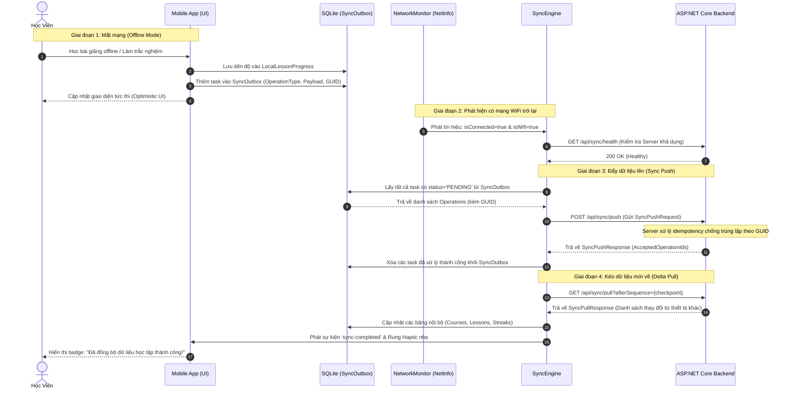

# GIÁO ÁN THIẾT KẾ & TRIỂN KHAI FRONTEND MOBILE (REACT NATIVE / EXPO)
## HỆ THỐNG HỌC TẬP THÔNG MINH MICROLEARNING
> **Dành cho AI & Senior Mobile Engineer** | **Phiên bản:** 2.0-Production  
> **Cam kết:** 100% API thật, Không Demo/Mock giả lập, Không Spaghetti Code, TypeScript Strict Mode, SQLite Offline & Auto-Sync khi có WiFi.

---

## 1. TỔNG QUAN DỰ ÁN & MỤC TIÊU KỸ THUẬT (PROJECT OVERVIEW)

### 1.1. Bối cảnh & Mục tiêu
- **Mục tiêu:** Xây dựng ứng dụng di động nguyên bản (Native Mobile App) đa nền tảng (iOS & Android) cho hệ thống **MicroLearning**, tái hiện **100% phong cách giao diện Cyber Dark tinh tế, hiện đại** của phiên bản Web hiện tại trên thiết bị di động (Theme `#070B18`, neon cyan `#06B6D4`, indigo `#6366F1`, amber `#F59E0B`, card glassmorphism).
- **Trọng tâm đặc thù:** Khác với bản Web, phiên bản Mobile phải hỗ trợ **Học Ngoại Tuyến (Offline-First)**: Cho phép học viên tải video bài học và trắc nghiệm về lưu trữ nội bộ vào **SQLite + FileSystem**, theo dõi tiến độ và làm bài khi không có mạng, sau đó **tự động đồng bộ hai chiều (Bi-directional Auto-Sync)** ngay khi thiết bị kết nối lại WiFi/Internet mà không gây xung đột dữ liệu hay gián đoạn trải nghiệm người dùng.
- **Tiêu chuẩn chất lượng:** Tuyệt đối không viết code demo, không bỏ dở với `// TODO`, không dùng kiểu `any`, không lừa dối bằng dữ liệu giả mạo (hardcoded mock data). Toàn bộ hệ thống phải kết nối trực tiếp vào Backend API ASP.NET Core thật.

---

## 2. TECH STACK & TIÊU CHUẨN KỸ THUẬT BẮT BUỘC (STRICT TECH STACK)

| Phân hệ | Công nghệ bắt buộc | Lý do & Yêu cầu |
| :--- | :--- | :--- |
| **Core Framework** | **React Native (v0.74+) + Expo SDK (v51+)** | Sử dụng Expo Managed Workflow với cấu trúc **Expo Router v3+** (File-based routing tương tự Next.js). |
| **Ngôn ngữ** | **TypeScript (Strict Mode: 100%)** | `noImplicitAny: true`, `strictNullChecks: true`. Tuyệt đối cấm `any` và JavaScript thuần `.js`. |
| **Styling & UI** | **NativeWind v4 (Tailwind CSS cho RN)** + `StyleSheet.create` | Đảm bảo đồng bộ 1:1 class Tailwind từ bản Web. Tối ưu CSS compile sang React Native StyleSheet, tránh bridge overhead. |
| **Safe Area & Layout** | **`react-native-safe-area-context`** | Bắt buộc bọc mọi screen, xử lý triệt để tai thỏ, Dynamic Island trên iPhone và thanh điều hướng cảm ứng Android. |
| **Server State** | **TanStack Query (React Query v5)** | Quản lý cache, stale time, retry, optimistic updates, và tự động refetch khi online trở lại. |
| **Global Client State** | **Zustand (v4.5+)** | Quản lý Auth State, Active Lesson, Download Tasks, Sync Status (nhẹ hơn Redux, zero-boilerplate). |
| **Form & Validation** | **React Hook Form + Zod** | Validate schema chặt chẽ từ phía client cho Form đăng nhập, đăng ký, OTP, mật khẩu bảo vệ khóa học. |
| **Offline Database** | **`expo-sqlite` (next API)** | Lưu trữ cấu trúc khóa học offline, lịch sử làm quiz, tiến độ xem video, và hàng đợi `SyncOutbox`. |
| **Offline File Storage** | **`expo-file-system`** | Tải và lưu trữ tệp tin nhị phân (Video MP4, File đính kèm tài liệu học tập, Audio TTS). |
| **Bảo mật & Storage** | **`expo-secure-store`** | Lưu trữ JWT Access Token, Refresh Token, Hardware DeviceId mã hóa cấp phần cứng (Keychain iOS / KeyStore Android). |
| **Giám sát Mạng** | **`@react-native-community/netinfo`** | Bắt sự kiện chuyển đổi trạng thái mạng (Offline <-> Cellular <-> WiFi) theo thời gian thực. |
| **Trình phát Media** | **`expo-av`** hoặc **`react-native-video`** | Hỗ trợ phát cả Online Streaming HLS/MP4 và Local Offline File từ SQLite/FileSystem. Chống tua bỏ bài học (Interval Union). |
| **Haptic Feedback** | **`expo-haptics`** | Rung phản hồi cảm ứng khi hoàn thành bài (+1 Streak 🔥), nộp bài thi đỗ, hoặc thao tác điều hướng. |

---

## 3. CẤU TRÚC THƯ MỤC CHUẨN FEATURE-BASED MODULAR

```text
mobile/
├── app/                                # EXPO ROUTER FILE-BASED NAVIGATION
│   ├── (auth)/                         # Phân hệ Xác thực
│   │   ├── _layout.tsx
│   │   ├── login.tsx                   # Màn hình Đăng nhập
│   │   ├── register.tsx                # Màn hình Đăng ký
│   │   ├── verify-otp.tsx              # Xác thực OTP
│   │   └── forgot-password.tsx         # Quên mật khẩu
│   ├── (tabs)/                         # Thanh điều hướng chính (Bottom Tab Bar)
│   │   ├── _layout.tsx
│   │   ├── index.tsx                   # Tab 1: Khám phá Khóa học (Catalog)
│   │   ├── study.tsx                   # Tab 2: Phòng học & Video Player (Workspace)
│   │   ├── notebook.tsx                # Tab 3: NoteBook Trợ lý AI & Podcast
│   │   ├── offline.tsx                 # Tab 4: Thư viện Ngoại tuyến (Offline Library)
│   │   └── profile.tsx                 # Tab 5: Hồ sơ cá nhân & Thống kê
│   ├── course/
│   │   └── [id].tsx                    # Chi tiết khóa học & Mở khóa mật khẩu
│   ├── lesson/
│   │   └── [id].tsx                    # Màn hình học bài giảng chuyên sâu
│   ├── quiz/
│   │   ├── [id].tsx                    # Màn hình làm bài thi trắc nghiệm
│   │   └── mistake-vault.tsx           # Sổ tay ôn tập câu sai
│   ├── _layout.tsx                     # Root Layout: Providers, Auth Guard, Network Listener
│   └── +not-found.tsx
├── src/
│   ├── assets/                         # Ảnh, icons, fonts Cyberpunk / Inter
│   ├── components/                     # REUSABLE PRESENTATIONAL COMPONENTS
│   │   ├── common/
│   │   │   ├── CyberHeader.tsx         # Header chuẩn Web: Logo, Streak 🔥, Crown 👑, Heart, Mistake
│   │   │   ├── StreakCrownBadge.tsx    # Huy hiệu Streak + Modal Vương Miện
│   │   │   ├── FullscreenCurriculum.tsx# Danh mục bài học Fullscreen Modal độc lập (Khắc phục lỗi cuộn)
│   │   │   ├── NetworkStatusBanner.tsx # Thanh thông báo Offline / Syncing
│   │   │   └── ErrorBoundary.tsx       # Bắt lỗi crash giao diện
│   │   ├── player/
│   │   │   ├── CustomVideoPlayer.tsx   # Trình phát Video online/offline chống tua
│   │   │   ├── AudioTtsPlayer.tsx      # Trình phát giọng đọc Edge-TTS
│   │   │   └── BookmarkTimeline.tsx    # Cắm cờ mốc thời gian học
│   │   ├── quiz/
│   │   │   ├── QuizCard.tsx            # Thẻ trắc nghiệm tương tác
│   │   │   └── QuizTimer.tsx           # Bộ đếm thời gian
│   │   └── ui/                         # Atomic UI: Button, Input, Modal, Badge, Card, Skeleton
│   ├── database/                       # SQLITE DATABASE ENGINE
│   │   ├── connection.ts               # Khởi tạo kết nối SQLite database
│   │   ├── schema.ts                   # DDL tạo bảng: Courses, Lessons, Quizzes, Outbox
│   │   ├── repositories/               # Thao tác CRUD dữ liệu nội bộ
│   │   │   ├── lessonRepository.ts     # Truy vấn bài học offline
│   │   │   ├── progressRepository.ts   # Lưu tiến độ học tập nội bộ
│   │   │   ├── quizRepository.ts       # Lưu câu trả lời & điểm thi offline
│   │   │   └── outboxRepository.ts     # Thêm/Xóa các task trong hàng đợi SyncOutbox
│   ├── services/                       # API CLIENT & BACKGROUND WORKERS
│   │   ├── api/                        # Axios HTTP Client
│   │   │   ├── client.ts               # Axios instance với Interceptors & Refresh Token Mutex
│   │   │   ├── authApi.ts              # Gọi API /api/auth/*
│   │   │   ├── catalogApi.ts           # Gọi API /api/courses/*
│   │   │   ├── progressApi.ts          # Gọi API /api/progress/*
│   │   │   ├── quizApi.ts              # Gọi API /api/quizzes/*
│   │   │   ├── streakApi.ts            # Gọi API /api/streak/*
│   │   │   └── syncApi.ts              # Gọi API /api/sync/push, /api/sync/pull
│   │   ├── offline/
│   │   │   ├── downloadManager.ts      # Quản lý tải Video ngầm, resumable, hủy tải
│   │   │   └── offlineStorage.ts       # Quản lý thư mục FileSystem
│   │   └── sync/
│   │       ├── syncEngine.ts           # BỘ NÃO ĐỒNG BỘ: Kích hoạt khi có WiFi
│   │       └── networkMonitor.ts       # Lắng nghe trạng thái mạng từ NetInfo
│   ├── store/                          # GLOBAL CLIENT STATE (ZUSTAND)
│   │   ├── authStore.ts                # User info, token, quyền hạn
│   │   ├── studyStore.ts               # Current course, lesson, watched time
│   │   ├── downloadStore.ts            # Danh sách tác vụ đang tải, phần trăm tiến trình
│   │   └── syncStore.ts                # Trạng thái đồng bộ (Pending count, Last synced time)
│   ├── types/                          # TYPESCRIPT STRICT DEFINITIONS
│   │   ├── auth.types.ts
│   │   ├── catalog.types.ts
│   │   ├── progress.types.ts
│   │   ├── quiz.types.ts
│   │   ├── streak.types.ts
│   │   ├── sync.types.ts
│   │   └── database.types.ts
│   └── utils/                          # HELPER FUNCTIONS
│       ├── secureStorage.ts            # Đóng gói expo-secure-store an toàn
│       ├── formatters.ts               # Format ngày giờ, thời lượng video (04:32)
│       ├── antiCheatEvaluator.ts       # Thuật toán Interval Union chống tua phía client
│       └── constants.ts                # API_URL, THEME_COLORS, STORAGE_KEYS
├── tailwind.config.js                  # Cấu hình NativeWind (Bảng màu Cyber Dark)
├── babel.config.js
├── app.json                            # Expo Config (Permissions, Bundle Identifier, Plugins)
├── tsconfig.json                       # TypeScript Strict Configuration
└── package.json
```

---

## 4. BẢO MẬT & AN NINH MẠNG (SECURITY & ANTI-LEAKAGE)

Khi phát triển ứng dụng di động, các kỹ sư thường mắc sai lầm lưu trữ Token trong `AsyncStorage` (lưu plain text không mã hóa, dễ bị trích xuất khi máy bị root/jailbreak) hoặc hardcode API keys vào file JS. Dự án này bắt buộc tuân thủ 5 nguyên tắc an ninh tối cao:

### 4.1. Mã hóa cấp phần cứng với `expo-secure-store`
- **Quy tắc:** Mọi thông tin nhạy cảm bao gồm: `accessToken`, `refreshToken`, `hardwareDeviceId` **BẮT BUỘC** phải được lưu trữ qua `expo-secure-store` (tận dụng iOS Keychain với chuẩn `kSecAccessControl` và Android KeyStore với mã hóa AES-256 qua Android EncryptedSharedPreferences).
- **Mã nguồn đóng gói chuẩn (`src/utils/secureStorage.ts`):**
```typescript
import * as SecureStore from 'expo-secure-store';

const SECURE_OPTIONS: SecureStore.SecureStoreOptions = {
  keychainAccessible: SecureStore.AFTER_FIRST_UNLOCK,
};

export const secureStorage = {
  async setItem(key: string, value: string): Promise<void> {
    try {
      await SecureStore.setItemAsync(key, value, SECURE_OPTIONS);
    } catch (error) {
      console.error(`[SecureStore] Lỗi lưu key "${key}":`, error);
      throw error;
    }
  },

  async getItem(key: string): Promise<string | null> {
    try {
      return await SecureStore.getItemAsync(key, SECURE_OPTIONS);
    } catch (error) {
      console.warn(`[SecureStore] Lỗi đọc key "${key}":`, error);
      return null;
    }
  },

  async removeItem(key: string): Promise<void> {
    try {
      await SecureStore.deleteItemAsync(key, SECURE_OPTIONS);
    } catch (error) {
      console.error(`[SecureStore] Lỗi xóa key "${key}":`, error);
    }
  },
};
```

### 4.2. Che giấu API & Cấu hình Biến môi trường
- Sử dụng file `.env` được bảo vệ, **KHÔNG BAO GIỜ** push file `.env` chứa production keys lên Git.
- Tận dụng `expo-constants` để đọc biến cấu hình an toàn:
  ```typescript
  // src/utils/constants.ts
  import Constants from 'expo-constants';

  export const API_BASE_URL: string =
    Constants.expoConfig?.extra?.apiUrl || 'https://ashy-grass-0bf212c00.3.azurestaticapps.net';
  ```
- **Chống Reverse Engineering:** Không nhúng Google AI Studio / Gemini API Key trực tiếp vào Mobile client. Toàn bộ tính năng AI (NoteBook, Trợ lý bài học, Podcast) phải gọi thông qua cổng Backend ASP.NET Core (`/api/notebook/...`) để Backend gán API Key và kiểm soát token quota.

### 4.3. Axios Interceptor với Hàng đợi Tự động làm mới Token (Refresh Token Mutex Queue)
- Khi Access Token hết hạn (Server trả về mã HTTP `401 Unauthorized`), hệ thống phải tạm dừng các request khác, đẩy vào hàng đợi chờ, tự động gọi `/api/auth/refresh-token` bằng Refresh Token lưu trong Keychain, cập nhật Token mới và retry các request đang nghẽn mà người dùng không hề hay biết.

---

## 5. DANH SÁCH API BACKEND THỰC TẾ (REAL BACKEND API CONTRACT)

Toàn bộ các endpoint dưới đây đều là API thật đang chạy trên hệ thống Backend ASP.NET Core của dự án:

| Module | Phương thức | Endpoint | Mô tả nghiệp vụ |
| :--- | :---: | :--- | :--- |
| **Auth** | `POST` | `/api/auth/login` | Đăng nhập bằng SĐT + Password, trả về AccessToken & RefreshToken |
| **Auth** | `POST` | `/api/auth/register` | Đăng ký tài khoản học viên mới |
| **Auth** | `POST` | `/api/auth/refresh-token` | Làm mới AccessToken bằng RefreshToken |
| **Auth** | `POST` | `/api/auth/google-login` | Đăng nhập một chạm bằng Google ID Token |
| **Auth** | `POST` | `/api/auth/verify-otp` | Xác thực mã OTP gửi về điện thoại |
| **Catalog** | `GET` | `/api/courses` | Lấy danh sách khóa học (Public & Khóa có quyền truy cập) |
| **Catalog** | `GET` | `/api/courses/{id}` | Lấy chi tiết khóa học, cây môn học (Subjects) và bài học (Lessons) |
| **Catalog** | `POST` | `/api/courses/{id}/unlock` | Nhập mật khẩu mở khóa học phần Private |
| **Progress** | `POST` | `/api/progress/video-coverage`| Ghi nhận tiến độ xem video kèm Interval Union chống tua (>=80%) |
| **Progress** | `POST` | `/api/progress/events` | Lưu mốc thời gian học Monotonic (Chống tụt tiến độ) |
| **Progress** | `GET` | `/api/progress/completed` | Lấy mảng ID các bài học mà học viên đã hoàn tất |
| **Quiz** | `GET` | `/api/quizzes/lesson/{lessonId}`| Lấy đề thi trắc nghiệm (Tự động ẩn đáp án đúng để chống hack) |
| **Quiz** | `POST` | `/api/quizzes/submit` | Nộp bài thi trắc nghiệm, tính điểm và ghi nhận sổ câu sai |
| **Quiz Mistake**| `GET` | `/api/quizmistakes` | Lấy danh sách câu hỏi từng làm sai để ôn tập lại |
| **Gamification**| `GET` | `/api/streak/my-streak` | Lấy số ngày Streak liên tiếp 🔥 và trạng thái Vương Miện 👑 |
| **Gamification**| `POST`| `/api/streak/ping` | Điểm danh Streak ngày (Tự động tăng khi hoàn thành 1 bài học) |
| **Sync Engine** | `POST` | `/api/sync/push` | **[OFFLINE]** Đẩy batch thao tác offline (tiến độ, quiz) lên server |
| **Sync Engine** | `GET` | `/api/sync/pull` | **[OFFLINE]** Kéo danh sách thay đổi vi sai (Delta Pull) về mobile |
| **Sync Engine** | `GET` | `/api/sync/health` | Kiểm tra kết nối dịch vụ đồng bộ |

---

## 6. KIẾN TRÚC OFFLINE & SQLITE DATABASE ENGINE (OFFLINE STORAGE)

Để học viên có thể học tập trên máy bay, tàu xe hoặc nơi không có sóng, Mobile App thiết kế một hệ cơ sở dữ liệu **SQLite cục bộ** độc lập.

### 6.1. Sơ đồ Cấu trúc Bảng SQLite (`src/database/schema.ts`)

```sql
-- 1. BẢNG KHÓA HỌC NGOẠI TUYẾN
CREATE TABLE IF NOT EXISTS OfflineCourses (
    id INTEGER PRIMARY KEY,
    title TEXT NOT NULL,
    description TEXT,
    thumbnailUrl TEXT,
    category TEXT,
    authorName TEXT,
    totalLessons INTEGER DEFAULT 0,
    downloadedAt TEXT NOT NULL
);

-- 2. BẢNG MÔN HỌC NGOẠI TUYẾN
CREATE TABLE IF NOT EXISTS OfflineSubjects (
    id INTEGER PRIMARY KEY,
    courseId INTEGER NOT NULL,
    title TEXT NOT NULL,
    sortOrder INTEGER DEFAULT 0,
    FOREIGN KEY(courseId) REFERENCES OfflineCourses(id) ON DELETE CASCADE
);

-- 3. BẢNG BÀI HỌC NGOẠI TUYẾN
CREATE TABLE IF NOT EXISTS OfflineLessons (
    id INTEGER PRIMARY KEY,
    subjectId INTEGER NOT NULL,
    title TEXT NOT NULL,
    description TEXT,
    durationSeconds INTEGER DEFAULT 0,
    videoRemoteUrl TEXT,
    localVideoPath TEXT,              -- Đường dẫn file video trên thiết bị (file://...)
    isDownloaded INTEGER DEFAULT 0,  -- 0: Chưa tải, 1: Đã tải hoàn tất, 2: Đang tải
    downloadProgress REAL DEFAULT 0,  -- Tiến trình tải (0.0 -> 1.0)
    FOREIGN KEY(subjectId) REFERENCES OfflineSubjects(id) ON DELETE CASCADE
);

-- 4. BẢNG TIẾN ĐỘ BÀI HỌC CỤC BỘ
CREATE TABLE IF NOT EXISTS LocalLessonProgress (
    lessonId INTEGER PRIMARY KEY,
    watchedSeconds INTEGER DEFAULT 0,
    percent REAL DEFAULT 0,
    isCompleted INTEGER DEFAULT 0,    -- 0: Chưa xong, 1: Đã hoàn thành
    lastPlayedAt TEXT NOT NULL,
    FOREIGN KEY(lessonId) REFERENCES OfflineLessons(id) ON DELETE CASCADE
);

-- 5. BẢNG ĐỀ THI VÀ CÂU HỎI OFFLINE
CREATE TABLE IF NOT EXISTS OfflineQuizzes (
    id INTEGER PRIMARY KEY,
    lessonId INTEGER NOT NULL,
    title TEXT NOT NULL,
    passScore REAL DEFAULT 80.0,
    questionsJson TEXT NOT NULL       -- Mảng JSON chứa câu hỏi & phương án lựa chọn
);

-- 6. HÀNG ĐỢI ĐỒNG BỘ NGOẠI TUYẾN (SYNC OUTBOX) - QUAN TRỌNG NHẤT
CREATE TABLE IF NOT EXISTS SyncOutbox (
    clientOperationId TEXT PRIMARY KEY, -- GUID chuẩn RFC 4122
    operationType TEXT NOT NULL,        -- 'LESSON_PROGRESS' hoặc 'QUIZ_ATTEMPT'
    payloadJson TEXT NOT NULL,          -- Dữ liệu thao tác dạng JSON
    createdAt TEXT NOT NULL,
    status TEXT DEFAULT 'PENDING',       -- 'PENDING', 'SYNCING', 'FAILED'
    retryCount INTEGER DEFAULT 0
);
```

### 6.2. Cơ chế Tải Video Ngầm (`src/services/offline/downloadManager.ts`)
1. Sử dụng `FileSystem.createDownloadResumable()` của `expo-file-system`.
2. Lưu file vào đường dẫn an toàn:
   ```typescript
   const localUri = `${FileSystem.documentDirectory}downloads/videos/lesson_${lessonId}.mp4`;
   ```
3. Cập nhật tiến độ tải theo thời gian thực (0% -> 100%) lên Zustand store `downloadStore` để hiển thị Progress Bar trên màn hình.
4. Khi tải xong:
   - Ghi nhận `localVideoPath = localUri` và `isDownloaded = 1` vào bảng `OfflineLessons`.
   - Thông báo cho học viên: *"Đã tải bài học thành công! Bạn có thể học ngoại tuyến ngay bây giờ."*

---

## 7. CƠ CHẾ AUTO-SYNC KHI CÓ LẠI WIFI (NETWORK RECOVERY SYNC ENGINE)

Đây là chức năng quan trọng bậc nhất của ứng dụng di động:



### 7.1. Cấu trúc Payload của `SyncOutbox`
- **Thao tác 1: Tiến độ bài học (`LESSON_PROGRESS`):**
  ```json
  {
    "clientOperationId": "3fa85f64-5717-4562-b3fc-2c963f66afa6",
    "operationType": "LESSON_PROGRESS",
    "payloadJson": "{\"lessonId\": 102, \"watchedSeconds\": 360, \"percent\": 100.0}",
    "createdAt": "2026-10-07T14:30:00Z"
  }
  ```
- **Thao tác 2: Nộp bài thi trắc nghiệm (`QUIZ_ATTEMPT`):**
  ```json
  {
    "clientOperationId": "e7b1a2c3-d4e5-4f6a-b7c8-9d0e1f2a3b4c",
    "operationType": "QUIZ_ATTEMPT",
    "payloadJson": "{\"clientAttemptId\": \"e7b1a2c3-d4e5-4f6a-b7c8-9d0e1f2a3b4c\", \"quizId\": 15, \"answers\": [{\"questionId\": 1, \"selectedOptionIds\": [3]}]}",
    "createdAt": "2026-10-07T14:35:00Z"
  }
  ```

### 7.2. Tùy chọn Tiết kiệm Dữ liệu Di động (WiFi-Only Sync Guard)
- Học viên có thể bật cấu hình: *"Chỉ tự động đồng bộ và tải video khi kết nối WiFi"* trong mục Cài đặt.
- Hệ thống sử dụng NetInfo kiểm tra:
  ```typescript
  if (userSettings.wifiOnly && state.type !== NetInfoStateType.wifi) {
    console.log('[SyncEngine] Đang kết nối 4G/5G, tạm hoãn đồng bộ theo cài đặt người dùng.');
    return;
  }
  ```

---

## 8. THIẾT KẾ UI/UX MOBILE REACTIVE ĐỒNG BỘ BẢN WEB (CYBER DARK DESIGN SYSTEM)

Giao diện Mobile phải kế thừa trọn vẹn vẻ đẹp của bản Web với phong cách **Cyber Dark Gaming/Tech**:

### 8.1. Bảng màu Chuẩn (Palette Hex Tokens)
```javascript
// tailwind.config.js (NativeWind)
module.exports = {
  theme: {
    extend: {
      colors: {
        background: '#070B18',        // Màu nền tối sâu chủ đạo
        card: '#090D1A',              // Nền thẻ card bài giảng
        cardLight: '#0D1429',         // Nền modal nổi bật
        border: 'rgba(255, 255, 255, 0.1)', // Viền kính mờ
        primary: {
          DEFAULT: '#6366F1',         // Indigo
          hover: '#4F46E5',
        },
        cyan: {
          DEFAULT: '#06B6D4',         // Neon Cyan điểm nhấn
          glow: 'rgba(6, 182, 212, 0.25)',
        },
        amber: {
          DEFAULT: '#F59E0B',         // Ngọn lửa Streak 🔥
          bg: 'rgba(245, 158, 11, 0.15)',
        },
        emerald: {
          DEFAULT: '#10B981',         // Hoàn thành bài học
          bg: 'rgba(16, 185, 129, 0.15)',
        },
        rose: {
          DEFAULT: '#F43F5E',         // Môn yêu thích ❤️
          bg: 'rgba(244, 63, 94, 0.15)',
        }
      }
    }
  }
}
```

### 8.2. Các Thành phần Giao diện Trọng yếu (Key UI Components)

1. **CyberHeader (`src/components/common/CyberHeader.tsx`):**
   - Đặt ở đỉnh mọi màn hình, xử lý thụt lề bằng `useSafeAreaInsets()`.
   - Chứa Logo MicroLearn, Huy hiệu Streak ngọn lửa 🔥 (nhảy số trực tiếp), Vương miện danh dự 👑 (nếu đạt 100%), Nút Môn yêu thích ❤️, Nút Sổ câu sai ❓, và Avatar người dùng.
   - Chiều cao đồng bộ chuẩn `h-11` (44px) tương thích cảm ứng ngón tay.

2. **CustomVideoPlayer (`src/components/player/CustomVideoPlayer.tsx`):**
   - Hỗ trợ phát nguồn từ Internet (`videoRemoteUrl`) hoặc từ tệp nội bộ đã tải về (`localVideoPath`).
   - Tích hợp thuật toán chống tua Interval Union: Người học tua quá 20% thời lượng sẽ không được tính hoàn thành bài học.
   - Nút **"Hoàn thành bài (+1 🔥)"** nổi bật đặt ngay dưới video player: Chỉ cần bấm là lập tức tăng Streak ngày và lưu tiến độ vào SQLite + Outbox.

3. **FullscreenCurriculum Modal (`src/components/common/FullscreenCurriculum.tsx`):**
   - Khắc phục triệt để lỗi cuộn kép (lướt bị dính cả trên và dưới) bằng cách phủ trọn 100% màn hình thiết bị (`absolute inset-0 z-50 bg-background`).
   - Tách biệt vùng cuộn danh sách bằng `ScrollView` với `nestedScrollEnabled={false}` và `bounces={false}`.

4. **Thanh Bottom Tab Bar Native (`app/(tabs)/_layout.tsx`):**
   - Đặt cố định đáy màn hình, hiệu ứng nền mờ bóng bẩy (`blurEffect="dark"`), icon phát sáng khi được chọn.

---

## 9. QUY TRÌNH & LỘ TRÌNH TRIỂN KHAI TỪNG BƯỚC (IMPLEMENTATION MILESTONES)

Kỹ sư hoặc AI khi thực thi bản thiết kế này phải làm theo đúng 9 cột mốc độc lập (không nhảy cóc):

### Cột mốc 1: Khởi tạo Cấu trúc Dự án & Cấu hình Core
- Khởi tạo Expo app với TypeScript template.
- Cài đặt NativeWind v4, cấu hình `tailwind.config.js` với bảng màu Cyber Dark.
- Cấu hình Expo Router v3 với các thư mục `(auth)`, `(tabs)`.
- Thiết lập `src/utils/secureStorage.ts` kết nối `expo-secure-store`.

### Cột mốc 2: Xây dựng Network Layer & Authentication
- Viết Axios client với Base URL và Request Interceptor tự động gán Bearer Token từ Keychain.
- Viết Response Interceptor xử lý lỗi 401: Mutex Queue tự động gọi `/api/auth/refresh-token`.
- Xây dựng màn hình Đăng nhập (`login.tsx`), Đăng ký (`register.tsx`), Xác thực OTP bằng React Hook Form + Zod.

### Cột mốc 3: Khởi tạo SQLite Database & Repository Pattern
- Viết file `src/database/schema.ts` với đầy đủ 6 bảng DDL như mục 6.1.
- Viết hàm `initDatabase()` tự động chạy migration khi khởi động app lần đầu.
- Xây dựng các Repositories: `lessonRepository`, `progressRepository`, `outboxRepository`.

### Cột mốc 4: Xây dựng Giao diện Khám phá Khóa học (Catalog)
- Gọi API `/api/courses` qua TanStack Query.
- Hiển thị danh sách khóa học dạng lưới/danh sách với thẻ card Cyber Dark (Ảnh thumbnail, badge danh mục, tiến độ %, số bài học).
- Xây dựng Modal mở khóa học phần Private bằng mật khẩu phiên bản (`/api/courses/{id}/unlock`).

### Cột mốc 5: Trình phát Bài học (Workspace Player) & Chống tua
- Xây dựng màn hình `app/lesson/[id].tsx` với `CustomVideoPlayer`.
- Hỗ trợ phát nguồn online và offline.
- Tích hợp tính năng cắm cờ mốc thời gian (Media Bookmarks) lưu vào SQLite.
- Gắn nút **"Hoàn thành bài (+1 🔥)"** kích hoạt điểm danh Streak.

### Cột mốc 6: Hệ thống Đề thi Trắc nghiệm & Sổ câu sai
- Xây dựng màn hình `app/quiz/[id].tsx` nạp đề thi từ API hoặc từ SQLite `OfflineQuizzes`.
- Xử lý nộp bài: Nếu online gọi `/api/quizzes/submit`, nếu offline lưu vào `SyncOutbox`.
- Hiển thị Sổ câu sai (`mistake-vault.tsx`) để học viên luyện tập lại các câu đã làm hỏng.

### Cột mốc 7: Hệ thống Gamification (Daily Streak & Master Crown)
- Xây dựng component `StreakCrownBadge` với ngọn lửa chuyển động lấp lánh.
- Gọi `/api/streak/my-streak` nạp dữ liệu.
- Kích hoạt sự kiện toàn cục tăng Streak ngay khi học viên hoàn thành bất kỳ 1 bài học nào trong ngày.

### Cột mốc 8: Bộ Quản lý Tải Ngoại Tuyến & Auto-Sync Engine
- Xây dựng `downloadManager.ts`: Cho phép bấm tải bài học về máy, theo dõi tiến trình %, lưu trữ file vào `FileSystem.documentDirectory`.
- Xây dựng `syncEngine.ts`: Lắng nghe NetInfo, khi có WiFi thì tự động quét `SyncOutbox` và gọi `/api/sync/push` kèm `/api/sync/pull`.
- Hiển thị màn hình Thư viện Ngoại tuyến (`app/(tabs)/offline.tsx`) quản lý dung lượng ổ đĩa và danh sách bài học đã tải.

### Cột mốc 9: Kiểm thử Tích hợp & Kiểm tra An ninh Toàn diện
- Kiểm thử luồng mất mạng đột ngột khi đang học: Đảm bảo không bị crash và dữ liệu được ghi vào Outbox an toàn.
- Kiểm thử luồng có lại WiFi: Đảm bảo hàng đợi Outbox được xả sạch lên Server và Server ghi nhận chính xác.
- Audit mã nguồn: Không còn bất kỳ kiểu `any` nào, không rò rỉ API key, chuẩn hóa Conventional Commits.

---

## 10. TIÊU CHUẨN KIỂM THỬ & CHỐNG "SPAGHETTI / HAPPY CODE" (AUDIT CHECKLIST)

Bất kỳ AI hoặc lập trình viên nào nhận giáo án này phải tự đối chiếu với bảng kiểm tra trước khi bàn giao:

- [ ] **1. Không có Mock Data:** Toàn bộ API gọi đúng URL và nhận đúng cấu trúc DTO của Backend.
- [ ] **2. Không có `any`:** 100% tệp tin TypeScript biên dịch sạch sẽ không có cảnh báo (`tsc --noEmit` đạt 0 lỗi).
- [ ] **3. An toàn Token:** AccessToken và RefreshToken được lưu trong `expo-secure-store`, không lưu trong `AsyncStorage`.
- [ ] **4. SQLite Transaction:** Các thao tác ghi nhiều bản ghi cùng lúc vào SQLite phải được bọc trong `db.withTransactionAsync()`.
- [ ] **5. Idempotent Sync:** Các task trong `SyncOutbox` bắt buộc mang mã `clientOperationId` (GUID) để máy chủ không bị ghi nhận trùng lặp dữ liệu khi kết nối chập chờn.
- [ ] **6. Không giật lag giao diện:** Danh sách bài học dài phải dùng `FlashList` hoặc `FlatList` với `keyExtractor` chuẩn, không dùng `ScrollView.map()`.
- [ ] **7. Giao diện Cyber Dark chuẩn mực:** Màu sắc, khoảng cách padding, bo góc `rounded-2xl`, hiệu ứng phát sáng neon đồng bộ 100% với bản Web trên mobile.

---
*Tài liệu này là đặc tả kỹ thuật chính thức (Source of Truth) cho việc xây dựng ứng dụng di động MicroLearning.*
