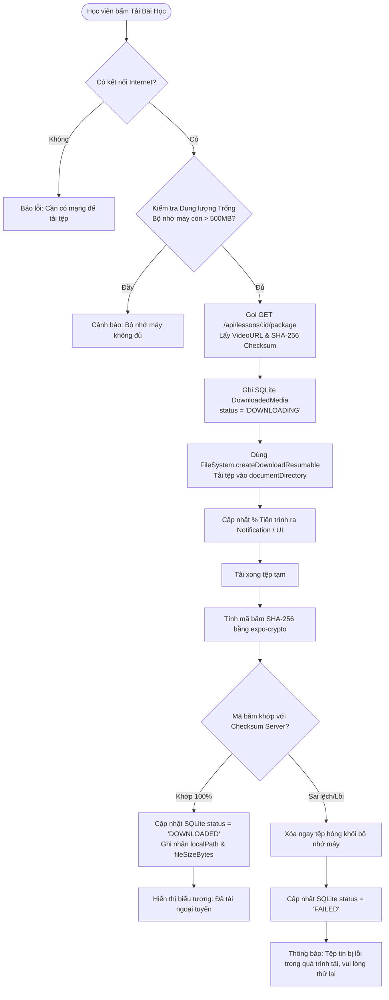

# QUY TẮC & LỘ TRÌNH PHÁT TRIỂN MOBILE APP OFFLINE-FIRST (REACT NATIVE + SQLITE)
## Dự án: Microlearning Video Platform (Cross-Platform Mobile App)

> **Cấp độ kiến trúc:** Senior Frontend Mobile Engineer (React Native & Offline-First Systems)  
> **Áp dụng cho:** Toàn bộ quá trình lập trình giao diện & logic phía Mobile Client  
> **Nguyên tắc cốt lõi:** Không Code Demo, Không Happy-Path Code, 100% Type-Safe TypeScript, Offline-First Tự Động.

---

## 1. NGUYÊN TẮC THIẾT KẾ & TIÊU CHUẨN KỸ THUẬT BẮT BUỘC

### 1.1. Công nghệ & Thư viện quy chuẩn
- **Nền tảng:** React Native 0.74+ chạy trên nền **Expo SDK 51+** (sử dụng **Expo Router v3** cho điều hướng dạng file-system).
- **Ngôn ngữ:** TypeScript ở chế độ nghiêm ngặt nhất (`strict: true`, `noImplicitAny: true`, tuyệt đối không dùng kiểu `any`).
- **Cơ sở dữ liệu cục bộ (Local Storage):**
  - **SQLite (`expo-sqlite` Next-Gen API):** Quản lý toàn bộ cấu trúc dữ liệu quan hệ, tiến độ, hàng đợi Outbox, bộ câu hỏi Quiz và metadata tệp.
  - **Secure Storage (`expo-secure-store`):** Lưu trữ mã hóa phần cứng (Keychain trên iOS / KeyStore trên Android) cho JWT `accessToken`, `refreshToken`, `userId`.
  - **File System (`expo-file-system`):** Lưu trữ nhị phân các tệp Video `.mp4` và Audio `.mp3` tải về vào thư mục an toàn của ứng dụng (`documentDirectory`).
- **Mạng & Trạng thái:**
  - `@react-native-community/netinfo`: Giám sát kết nối mạng thời gian thực.
  - `@tanstack/react-query`: Đồng bộ hóa Server State và bộ đệm tầng API.
  - `zustand`: Quản lý Global Client State (trạng thái đồng bộ, tiến trình download, phiên đăng nhập).
- **Giao diện & Trải nghiệm:**
  - NativeWind (Tailwind cho React Native) hoặc `StyleSheet.create` tối ưu.
  - Bắt buộc bọc màn hình bằng `SafeAreaView` (từ `react-native-safe-area-context`).
  - Toàn bộ form nhập liệu bắt buộc dùng `KeyboardAvoidingView` + `TouchableWithoutFeedback` (dismiss keyboard) + `ScrollView`.
  - Danh sách bài học/khóa học bắt buộc dùng `FlashList` (Shopify) hoặc `FlatList` với đầy đủ `keyExtractor`, `getItemLayout`, không dùng `map()` trong `ScrollView`.

---

## 2. LUỒNG XÁC THỰC TINH GỌN (STREAMLINED AUTHENTICATION)

Khác với các ứng dụng thương mại cần màn hình quảng cáo tính năng (Onboarding/Intro Walkthrough), ứng dụng này **bỏ qua hoàn toàn Onboarding/Carousel giới thiệu**. Quy trình đăng nhập đi thẳng vào trọng tâm:

```mermaid
flowchart TD
    AppLaunch([Khởi động App]) --> CheckToken{Kiểm tra SecureStore<br/>accessToken & refreshToken}
    
    CheckToken -- Có Token & Hợp lệ --> FetchDevice[Lấy DeviceID & Check Network]
    FetchDevice --> ToMainApp[Vào thẳng Tab Chính<br/>app/(tabs)/index.tsx]
    
    CheckToken -- Token Hết hạn --> TryRefresh{Gọi Refresh Token API}
    TryRefresh -- Thành công --> ToMainApp
    TryRefresh -- Thất bại / Chưa có Token --> ToLogin[Vào thẳng Màn hình Đăng nhập<br/>app/(auth)/login.tsx]
    
    ToLogin --> FormLogin[Nhập Số điện thoại / Mật khẩu]
    FormLogin --> SubmitAuth{Gọi API /api/auth/login}
    SubmitAuth -- Thành công --> SaveTokens[Lưu SecureStore + Đăng ký DeviceID]
    SaveTokens --> InitLocalDB[Khởi tạo / Nạp SQLite Schema]
    InitLocalDB --> AutoSyncTrigger[Kích hoạt Auto-Sync Pull]
    AutoSyncTrigger --> ToMainApp
    
    SubmitAuth -- Thất bại --> ShowToast[Hiển thị Toast lỗi rõ ràng<br/>Không văng App]
```

### 2.1. Quy tắc thiết kế Màn hình Auth:
1. **Màn hình Đăng nhập (`app/(auth)/login.tsx`):**
   - Chỉ gồm: Logo ứng dụng, Tiêu đề ngắn gọn, Input Tài khoản/SĐT, Input Mật khẩu (có nút ẩn/hiện mắt), Nút "Đăng nhập", và liên kết chuyển nhanh "Chưa có tài khoản? Đăng ký".
   - Tự động `autoCapitalize="none"`, `keyboardType="phone-pad"` hoặc `"email-address"`, hỗ trợ Auto-fill mật khẩu.
   - Validate client-side bằng **Zod Schema** trước khi gửi request tới server.
2. **Đăng ký thiết bị tự động (`Device Registration`):**
   - Ngay sau khi Auth thành công, lấy mã phần cứng `Application.getIosIdForVendorAsync()` hoặc `Application.getAndroidId()` kết hợp `Device.modelName`.
   - Gọi ngầm `POST /api/devices/register` để đồng bộ Device Token. Người dùng không cần thao tác bước này.

---

## 3. THIẾT KẾ CƠ SỞ DỮ LIỆU CỤC BỘ SQLITE (DATA CONTRACT)

> **Quy tắc bất di bất dịch:** Tuyệt đối **KHÔNG lưu dữ liệu nhị phân (Blob/Binary Video)** vào SQLite. SQLite chỉ quản lý metadata văn bản, số liệu và đường dẫn vật lý `localPath` tới file trong `FileSystem.documentDirectory`.

```sql
-- =========================================================================
-- 1. HÀNG ĐỢI ĐỒNG BỘ NGOẠI TUYẾN (OUTBOX PATTERN)
-- =========================================================================
CREATE TABLE IF NOT EXISTS SyncOutbox (
    clientOperationId TEXT PRIMARY KEY,        -- GUID v4 duy nhất cho mỗi hành động
    operationType TEXT NOT NULL,               -- 'LESSON_PROGRESS' | 'QUIZ_ATTEMPT'
    entityType TEXT NOT NULL,                  -- 'Lesson' | 'Quiz'
    entityId INTEGER NOT NULL,
    payloadJson TEXT NOT NULL,                 -- Nội dung chi tiết thao tác dạng JSON
    createdAt TEXT NOT NULL,                   -- ISO-8601 UTC timestamp
    retryCount INTEGER DEFAULT 0,              -- Số lần đã thử gửi lại khi lỗi
    lastError TEXT,                            -- Ghi nhận lỗi mạng / HTTP status gần nhất
    status TEXT DEFAULT 'PENDING'              -- 'PENDING' | 'SENDING' | 'FAILED'
);
CREATE INDEX IF NOT EXISTS idx_outbox_status ON SyncOutbox(status);

-- =========================================================================
-- 2. METADATA VÀ MỐC KIỂM SOÁT ĐỒNG BỘ (SYNC CHECKPOINT)
-- =========================================================================
CREATE TABLE IF NOT EXISTS SyncMeta (
    key TEXT PRIMARY KEY,                      -- 'last_sequence_number', 'last_sync_time'
    value TEXT NOT NULL,
    updatedAt TEXT NOT NULL
);

-- =========================================================================
-- 3. CACHE KHÓA HỌC & DANH MỤC PHÂN CẤP (CATALOG LOCAL REPO)
-- =========================================================================
CREATE TABLE IF NOT EXISTS LocalCourses (
    id INTEGER PRIMARY KEY,
    title TEXT NOT NULL,
    description TEXT,
    thumbnailUrl TEXT,
    version INTEGER DEFAULT 1,
    isPublished INTEGER DEFAULT 1,
    totalSubjects INTEGER DEFAULT 0,
    updatedAt TEXT NOT NULL
);

CREATE TABLE IF NOT EXISTS LocalSubjects (
    id INTEGER PRIMARY KEY,
    courseId INTEGER NOT NULL,
    title TEXT NOT NULL,
    description TEXT,
    sortOrder INTEGER DEFAULT 1,
    totalLessons INTEGER DEFAULT 0,
    FOREIGN KEY (courseId) REFERENCES LocalCourses(id) ON DELETE CASCADE
);
CREATE INDEX IF NOT EXISTS idx_subjects_course ON LocalSubjects(courseId);

CREATE TABLE IF NOT EXISTS LocalLessons (
    id INTEGER PRIMARY KEY,
    subjectId INTEGER NOT NULL,
    title TEXT NOT NULL,
    description TEXT,
    durationSeconds INTEGER DEFAULT 0,
    sortOrder INTEGER DEFAULT 1,
    version INTEGER DEFAULT 1,
    isPublished INTEGER DEFAULT 1,
    hasQuiz INTEGER DEFAULT 0,
    mediaAssetCount INTEGER DEFAULT 0,
    FOREIGN KEY (subjectId) REFERENCES LocalSubjects(id) ON DELETE CASCADE
);
CREATE INDEX IF NOT EXISTS idx_lessons_subject ON LocalLessons(subjectId);

-- =========================================================================
-- 4. QUẢN LÝ TỆP TIN VIDEO TẢI VỀ (OFFLINE MEDIA VAULT)
-- =========================================================================
CREATE TABLE IF NOT EXISTS DownloadedMedia (
    mediaId INTEGER PRIMARY KEY,
    lessonId INTEGER NOT NULL,
    fileName TEXT NOT NULL,
    localPath TEXT NOT NULL,                   -- FileSystem.documentDirectory + 'videos/...'
    fileSizeBytes INTEGER NOT NULL,
    checksum TEXT NOT NULL,                    -- SHA-256 từ Server để xác thực toàn vẹn
    downloadedAt TEXT NOT NULL,
    lastPlayedAt TEXT NOT NULL,
    isPinned INTEGER DEFAULT 0,                -- 1 = Không bao giờ tự xóa trong kỳ dọn dẹp
    status TEXT NOT NULL,                      -- 'DOWNLOADING' | 'DOWNLOADED' | 'FAILED'
    FOREIGN KEY (lessonId) REFERENCES LocalLessons(id) ON DELETE CASCADE
);
CREATE UNIQUE INDEX IF NOT EXISTS idx_download_lesson ON DownloadedMedia(lessonId);

-- =========================================================================
-- 5. TIẾN ĐỘ HỌC TẬP NGOẠI TUYẾN
-- =========================================================================
CREATE TABLE IF NOT EXISTS LocalLessonProgress (
    lessonId INTEGER PRIMARY KEY,
    watchedSeconds INTEGER DEFAULT 0,
    percent REAL DEFAULT 0.0,
    isCompleted INTEGER DEFAULT 0,
    completedAt TEXT,
    lastPlayedAt TEXT NOT NULL,
    isDirty INTEGER DEFAULT 0                  -- 1 = Có thay đổi cục bộ chưa đẩy lên server
);

-- =========================================================================
-- 6. GÓI ĐỀ THI VÀ KẾT QUẢ THI NGOẠI TUYẾN (OFFLINE QUIZ VAULT)
-- =========================================================================
CREATE TABLE IF NOT EXISTS LocalQuizzes (
    quizId INTEGER PRIMARY KEY,
    lessonId INTEGER NOT NULL UNIQUE,
    title TEXT NOT NULL,
    passScore INTEGER DEFAULT 80,
    version INTEGER DEFAULT 1,
    questionsJson TEXT NOT NULL,               -- Câu hỏi & các đáp án (không có IsCorrect)
    updatedAt TEXT NOT NULL,
    FOREIGN KEY (lessonId) REFERENCES LocalLessons(id) ON DELETE CASCADE
);

CREATE TABLE IF NOT EXISTS LocalQuizAttempts (
    clientAttemptId TEXT PRIMARY KEY,          -- GUID sinh ngẫu nhiên khi bắt đầu thi
    quizId INTEGER NOT NULL,
    lessonId INTEGER NOT NULL,
    score REAL DEFAULT 0.0,
    isPassed INTEGER DEFAULT 0,
    submittedAt TEXT NOT NULL,
    answersJson TEXT NOT NULL,                 -- Mảng câu trả lời đã chọn của học viên
    syncStatus TEXT DEFAULT 'PENDING'          -- 'PENDING' | 'SYNCED'
);
```

---

## 4. CƠ CHẾ ĐỒNG BỘ TỰ ĐỘNG 100% (ZERO-MANUAL AUTO-SYNC ENGINE)

Tuyệt đối **không bắt học viên phải bấm nút đồng bộ thủ công**. Ứng dụng phải tự nhận biết ngữ cảnh, chạy ngầm một cách trong suốt theo mô hình sau:

```mermaid
sequenceDiagram
    autonumber
    participant App as 📱 Mobile App (React Native)
    participant Net as 📡 NetInfo Monitor
    participant DB as 💾 SQLite (Outbox)
    participant Server as ☁️ Backend API (.NET 8)

    Note over App,DB: Khi mất mạng (Offline Mode)
    App->>DB: Học viên xem video / Nộp Quiz -> Ghi LocalProgress & SyncOutbox (PENDING)
    
    Note over Net,App: Phát hiện có mạng trở lại (Online Trigger)
    Net-->>App: onNetworkChange: isConnected = true, isInternetReachable = true
    App->>App: Khóa Mutex Lock + Chờ Debounce 2 giây (Chống chập chờn)
    
    rect rgb(30, 41, 59)
    Note over App,Server: Pha 1: PUSH (Đẩy dữ liệu phát sinh ngoại tuyến lên Server)
    App->>DB: Lấy danh sách Outbox (tối đa 50 item, ORDER BY createdAt ASC)
    DB-->>App: Trả về mảng SyncBatchItemDTO
    App->>Server: POST /api/sync/push { operations: [...] }
    Server->>Server: Transaction ACID: Monotonic Merge Progress & Idempotency Quiz
    Server-->>App: 200 OK { processedCount: N, errors: [] }
    App->>DB: Xóa sạch các item đã xử lý khỏi SyncOutbox
    end

    rect rgb(15, 23, 42)
    Note over App,Server: Pha 2: PULL (Kéo dữ liệu mới nhất từ Server về SQLite)
    App->>DB: Lấy last_sequence_number từ SyncMeta
    DB-->>App: Trả về sequence hiện tại (vd: 142)
    App->>Server: GET /api/sync/pull?afterSequence=142
    Server-->>App: 200 OK { changes: [...], newSequenceNumber: 156 }
    App->>DB: Cập nhật vi sai vào LocalCourses, LocalLessons, Progress
    App->>DB: Lưu last_sequence_number = 156 vào SyncMeta
    end
    
    App->>App: Mở khóa Mutex Lock -> Bắn sự kiện UI cập nhật (Zustand SyncState)
```



### 4.1. Bốn kích hoạt đồng bộ tự động (4 Automatic Triggers):
1. **Trigger 1 - Network Recovery:** Lắng nghe qua `@react-native-community/netinfo`. Khi chuyển trạng thái từ `offline` sang `online`, engine tự động kích hoạt.
2. **Trigger 2 - App Lifecycle Resume:** Sử dụng `AppState.addEventListener('change', ...)`. Khi học viên mở app hoặc chuyển từ chế độ nền (background) sang màn hình chính (active), engine kiểm tra hàng đợi Outbox.
3. **Trigger 3 - Action Completion:** Ngay khi học viên xem xong 1 bài giảng hoặc nộp bài Quiz, nếu đang có mạng thì đẩy ngay; nếu không có mạng thì tự ghi Outbox.
4. **Trigger 4 - Heartbeat Interval:** Khi đang online và app đang mở, định kỳ mỗi 3–5 phút chạy nhẹ một truy vấn `syncPull` để đón các bài giảng hoặc thông báo mới từ giảng viên.

### 4.2. Nguyên tắc an toàn phòng chống lỗi (Fault Tolerance):
- **Khóa đơn phiên (Mutex Lock):** Tuyệt đối không cho phép 2 tiến trình đồng bộ chạy cùng lúc để tránh race condition trên database SQLite.
- **Debounce 2.000ms:** Chống hiện tượng giật mạng/chập chờn WiFi kích hoạt đồng bộ liên tục.
- **Monotonic Merge:** Khi đồng bộ tiến độ xem video, luôn áp dụng quy tắc `Math.Max(serverPercent, clientPercent)` để không bao giờ ghi đè làm tụt lùi tiến độ học tập.
- **Idempotent Quiz Submission:** Mỗi lần nộp bài thi được gán một GUID `clientAttemptId`. Nếu gửi lại nhiều lần do mạng lag, Backend sẽ nhận diện theo GUID và không tính điểm lặp lại.
- **Exponential Backoff:** Nếu Server trả về lỗi 5xx hoặc quá tải, tăng dần thời gian thử lại (`retryCount * 5s`), không xóa bản ghi khỏi SQLite khi chưa nhận được phản hồi HTTP 200 thành công.

---

## 5. TẢI VIDEO & HỌC NGOẠI TUYẾN (OFFLINE VIDEO VAULT)

### 5.1. Quy trình tải Video an toàn & Đối soát mã băm SHA-256
Khác với Web chỉ xem trực tuyến, Mobile App cho phép tải video về bộ nhớ điện thoại để học khi đi máy bay, xe buýt hoặc mất mạng:



### 5.2. Logic Trình phát Video Thông minh (Hybrid Smart Video Player):
Khi học viên mở màn hình bài học `app/lesson/[id].tsx`, trình phát video tự động quyết định nguồn phát:
1. **Bước 1 (Kiểm tra Offline Cache):** Truy vấn SQLite bảng `DownloadedMedia` theo `lessonId`.
2. **Bước 2 (Kiểm tra tệp vật lý):** Nếu SQLite báo `DOWNLOADED`, kiểm tra thêm bằng `FileSystem.getInfoAsync(localPath)`.
   - Nếu tệp vật lý tồn tại ➡️ **Phát trực tiếp từ file cục bộ** (`file://...`). Tiết kiệm 100% dữ liệu di động, phát tức thì 0ms độ trễ.
3. **Bước 3 (Fallback Online Streaming):** Nếu không có file ngoại tuyến:
   - Nếu đang Online: Phát trực tuyến qua giao thức HTTP 206 Range Streaming từ Azure Storage.
   - Nếu đang Offline: Hiển thị màn hình thông báo thân thiện: *"Bài học này chưa được tải về. Vui lòng kết nối mạng để tiếp tục học."*

### 5.3. Chính sách Tự động Dọn dẹp sau 7 ngày (7-Day Auto-Cleanup & LRU Policy):
Để tránh làm đầy bộ nhớ của học viên:
- **Tiêu chí tự dọn dẹp:** Bài học thỏa mãn đồng thời:
  1. `isCompleted = 1` (Học viên đã học xong hoàn toàn bài giảng).
  2. `isPinned = 0` (Học viên không bật cờ "Ghim/Giữ lại bài học này").
  3. `lastPlayedAt <= (Thời điểm hiện tại - 7 ngày)`.
- **Hành động:** 
  - Xóa file `.mp4` vật lý khỏi bộ nhớ máy.
  - Cập nhật bản ghi trong SQLite, giữ lại metadata và tiến độ học tập để học viên có thể bấm tải lại bất cứ lúc nào.
- **Trình kích hoạt:** Chạy ngầm mỗi khi ứng dụng khởi động hoặc khi người dùng chuẩn bị tải một bài học mới có dung lượng lớn.

---

## 6. BỘ TIÊU CHÍ LẬP TRÌNH "KHÔNG HAPPY-CODE" (EDGE-CASE MATRIX)

Mọi dòng code viết cho Mobile App phải xử lý triệt để bảng tình huống biên sau đây:

| Tình huống rủi ro (Edge Case) | Hậu quả nếu viết code sơ sài (Happy-Path) | Cách giải quyết bắt buộc của Senior Mobile Dev |
| :--- | :--- | :--- |
| **Học viên tắt ngang app khi đang tải video 80%** | File bị lưu nửa chừng, chiếm bộ nhớ rác, lần sau mở app bị lỗi crash khi phát. | Dùng `FileSystem.createDownloadResumable` lưu trạng thái tạm thời. Khi mở lại app, xóa tệp `.tmp` nếu không tiếp tục tải; kiểm tra SHA-256 trước khi đánh dấu hoàn tất. |
| **Mất mạng đúng lúc bấm nộp bài thi Quiz** | Học viên bị mất điểm, màn hình xoay vô tận, app không lưu kết quả. | Tính điểm cục bộ ngay lập tức, lưu bài thi vào bảng `LocalQuizAttempts` với `syncStatus = 'PENDING'`, sinh mã `clientAttemptId` (GUID), báo học viên đã nộp bài thành công và sẽ tự đồng bộ khi có mạng. |
| **Token hết hạn (401) khi đang chạy Auto-Sync ngầm** | Request đồng bộ bị treo, dữ liệu outbox không gửi được, vòng lặp lỗi liên tục. | Viết Axios Interceptor tự động bắt mã 401, tạm dừng queue đồng bộ, gọi ngầm API Refresh Token bằng `refreshToken` trong SecureStore. Nếu refresh thành công thì thực thi tiếp; nếu thất bại mới đưa về Login. |
| **Điện thoại gần hết dung lượng bộ nhớ (<100MB)** | `expo-file-system` quăng ngoại lệ OS, app bị crash văng ra ngoài màn hình chủ. | Trước khi tải bất kỳ video nào, bắt buộc gọi hàm kiểm tra dung lượng trống của máy (`FileSystem.getFreeDiskStorageAsync()`). Nếu không đủ dung lượng thì từ chối tải và hiển thị cảnh báo giải phóng bộ nhớ. |
| **Hai thiết bị cùng học 1 bài (Điện thoại & Web)** | Tiến độ trên web ghi đè xóa mất tiến độ học viên vừa học trên điện thoại. | Sử dụng thuật toán Monotonic Merge: `FinalProgress = Math.Max(LocalPercent, ServerPercent)`. Tuyệt đối không nhận giá trị nhỏ hơn để ghi đè. |

---

## 7. CẤU TRÚC THƯ MỤC SOURCE CODE CHUẨN MỰC

```
mobile/
|-- app/                                  # Expo Router v3 (File-based Routing)
|   |-- _layout.tsx                       # Root Layout: Theme, SafeArea, QueryClient, SQLiteProvider
|   |-- (auth)/                           # Phân hệ Xác thực tinh gọn (Không Onboarding)
|   |   |-- login.tsx                     # Đăng nhập trực tiếp (SĐT / Mật khẩu)
|   |   |-- register.tsx                  # Đăng ký tài khoản mới
|   |-- (tabs)/                           # Bottom Tab Navigation chính
|   |   |-- _layout.tsx                   # Cấu hình Icons và nhãn các Tab
|   |   |-- index.tsx                     # Tab 1: Khóa học của tôi (Dashboard học tập)
|   |   |-- catalog.tsx                   # Tab 2: Khám phá tất cả khóa học
|   |   |-- downloads.tsx                 # Tab 3: Kho bài học tải ngoại tuyến & Quản lý bộ nhớ
|   |   |-- profile.tsx                   # Tab 4: Hồ sơ, Thiết bị & Trạng thái Đồng bộ
|   |-- course/
|   |   |-- [id].tsx                      # Chi tiết khóa học (Cây môn học & bài giảng)
|   |-- lesson/
|   |   |-- [id].tsx                      # Màn hình học: Trình phát Video Hybrid + Audio Podcast
|   |-- quiz/
|   |   |-- [id].tsx                      # Màn hình làm bài thi trắc nghiệm (Online & Offline)
|
|-- src/
|   |-- db/                               # Lõi SQLite Cục bộ
|   |   |-- sqliteClient.ts               # Khởi tạo kết nối SQLite với PRAGMA foreign_keys = ON
|   |   |-- schema.ts                     # Các câu lệnh DDL khởi tạo bảng và chỉ mục Index
|   |   |-- repositories/                 # Repository Pattern tách biệt truy vấn
|   |       |-- outboxRepository.ts       # Thêm/Xóa/Lấy danh sách hàng đợi đồng bộ
|   |       |-- catalogRepository.ts      # Đọc/Ghi dữ liệu khóa học, môn học, bài học
|   |       |-- downloadRepository.ts     # Quản lý trạng thái và danh sách video đã tải
|   |       |-- progressRepository.ts     # Cập nhật và truy vấn tiến độ học tập cục bộ
|   |       |-- quizRepository.ts         # Lưu gói đề thi và lưu kết quả nộp bài thi
|   |-- services/                         # Kết nối API & Networking
|   |   |-- apiClient.ts                  # Axios Client + Auto-Refresh Token Interceptor
|   |   |-- authApi.ts                    # Gọi API Auth, OTP, Device Registration
|   |   |-- catalogApi.ts                 # Gọi API Khóa học, Bài học, Gói bài học
|   |   |-- syncApi.ts                    # Gọi API Sync Push & Sync Pull Delta
|   |   |-- downloadManager.ts            # Quản lý tải tệp đa luồng, Resume, Tính Hash SHA-256
|   |   |-- autoSyncEngine.ts             # Động cơ tự động đồng bộ theo 4 Triggers + Mutex Lock
|   |   |-- mediaCleanupService.ts        # Dịch vụ tự dọn dẹp video sau 7 ngày theo chính sách LRU
|   |-- store/                            # Global State (Zustand)
|   |   |-- useAuthStore.ts               # Trạng thái đăng nhập & thông tin User
|   |   |-- useSyncStore.ts               # Trạng thái đồng bộ (IsSyncing, LastSyncAt, OutboxCount)
|   |   |-- useDownloadStore.ts           # Trạng thái tiến trình tải video & Quota bộ nhớ
|   |-- components/                       # UI Components dùng chung
|   |   |-- player/                       # HybridVideoPlayer, AudioPodcastPlayer
|   |   |-- quiz/                         # QuestionCard, OptionItem, QuizResultModal
|   |   |-- sync/                         # SyncStatusBadge, OfflineBanner
|   |   |-- download/                     # DownloadButton, StorageIndicatorBar
|   |-- hooks/                            # Custom Hooks
|   |   |-- useNetworkStatus.ts           # Hook theo dõi kết nối mạng NetInfo
|   |   |-- useLessonPlayer.ts            # Hook điều khiển video và tự lưu tiến độ
|   |-- types/                            # Định nghĩa TypeScript Interfaces chuẩn xác 100%
|       |-- auth.types.ts
|       |-- catalog.types.ts
|       |-- sync.types.ts
|       |-- download.types.ts
|       |-- quiz.types.ts
|-- .env                                  # Biến môi trường API Base URL
|-- app.json                              # Cấu hình Expo, Bundle Identifier, Permissions
```

---

## 8. LỘ TRÌNH THỰC THI CHUYÊN SÂU TỪNG GIAI ĐOẠN (ROADMAP)

### GIAI ĐOẠN 1: NỀN TẢNG DỰ ÁN, SQLITE LÕI & AUTH TINH GỌN (Ngày 1 - 2)
- [ ] Khởi tạo dự án Expo Router với TypeScript template.
- [ ] Viết `src/db/sqliteClient.ts` và `src/db/schema.ts` khởi tạo 6 bảng CSDL SQLite với đầy đủ chỉ mục (Indexes).
- [ ] Xây dựng `src/services/apiClient.ts` tích hợp Axios Interceptor bắt mã 401 tự động làm mới Token bằng `expo-secure-store`.
- [ ] Xây dựng màn hình `app/(auth)/login.tsx` và `register.tsx` (Validate Zod, không Onboarding, focus form nhanh chóng).
- [ ] Tích hợp lấy UUID phần cứng và tự động gọi `POST /api/devices/register` khi đăng nhập thành công.

### GIAI ĐOẠN 2: CACHE CSDL CỤC BỘ & ĐỘNG CƠ TỰ ĐỘNG ĐỒNG BỘ (Ngày 3 - 4)
- [ ] Viết các Repositories: `catalogRepository.ts`, `outboxRepository.ts`, `progressRepository.ts`.
- [ ] Xây dựng `src/services/autoSyncEngine.ts` với đầy đủ:
  - Khóa Mutex Lock chống chạy đè.
  - Debounce 2 giây khi kết nối mạng phục hồi qua `NetInfo`.
  - Pha 1: Gom Outbox gọi `POST /api/sync/push` (Transaction an toàn).
  - Pha 2: Gọi `GET /api/sync/pull?afterSequence=X` nạp vi sai vào SQLite.
- [ ] Gắn kích hoạt tự động vào vòng đời ứng dụng (`AppState` change) và sự kiện học tập.

### GIAI ĐOẠN 3: TẢI VIDEO NGOẠI TUYẾN & TRÌNH PHÁT HYBRID (Ngày 5 - 6)
- [ ] Xây dựng `src/services/downloadManager.ts`:
  - Kiểm tra dung lượng máy trước khi tải.
  - Tải video bằng `FileSystem.createDownloadResumable` kèm callback cập nhật phần trăm.
  - Tính toán mã băm SHA-256 bằng `expo-crypto` đối soát với Checksum từ Server.
  - Lưu bản ghi hoàn tất vào bảng `DownloadedMedia`.
- [ ] Xây dựng `src/components/player/HybridVideoPlayer.tsx`:
  - Tự động ưu tiên phát file local từ `DownloadedMedia`.
  - Fallback sang Range Streaming HTTP 206 khi đang online.
  - Tự động ghi nhận `watchedSeconds` và lưu tiến độ vào SQLite mỗi 5 giây.
- [ ] Xây dựng `src/services/mediaCleanupService.ts`: Tự động xóa file video bài đã học xong sau 7 ngày (trừ các bài được ghim `isPinned = 1`).

### GIAI ĐOẠN 4: HỆ THỐNG THI TRẮC NGHIỆM NGOẠI TUYẾN & TỔNG HỢP TIẾN ĐỘ (Ngày 7 - 8)
- [ ] Viết `src/db/repositories/quizRepository.ts` nạp và lưu trữ gói câu hỏi thi ngoại tuyến.
- [ ] Xây dựng màn hình thi `app/quiz/[id].tsx`:
  - Hỗ trợ làm bài trắc nghiệm trọn vẹn cả khi tắt toàn bộ WiFi / 4G (Chế độ máy bay).
  - Tự sinh `clientAttemptId` (GUID) và lưu kết quả vào `LocalQuizAttempts` kèm ghi vào `SyncOutbox`.
- [ ] Tích hợp Monotonic Merge đảm bảo điểm thi và tiến độ không bị xung đột khi có mạng trở lại.

### GIAI ĐOẠN 5: KIỂM THỬ KHẮC NGHIỆT, ĐÓNG GÓI APK & BÀN GIAO (Ngày 9 - 10)
- [ ] **Kiểm thử kịch bản Airplane Mode:** 
  1. Đăng nhập ➡️ Tải 2 video bài giảng ➡️ Bật Chế độ máy bay (ngắt mạng 100%).
  2. Mở app xem hết 2 video bài giảng ➡️ Làm bài thi trắc nghiệm đạt 100 điểm.
  3. Tắt Chế độ máy bay (bật lại mạng) ➡️ Quan sát Auto-Sync Engine tự động đẩy tiến độ và bài thi lên Azure SQL Server mà học viên không cần bấm bất kỳ nút nào.
- [ ] Tối ưu bộ nhớ, loại bỏ memory leak, kiểm tra không có re-render thừa.
- [ ] Cấu hình `app.json` và xuất bản file cài đặt Android (`.apk` / `.aab`) qua EAS Build.

---

## 9. QUY ƯỚC CAM KẾT GIT (FARM COMMIT & CONVENTIONAL COMMITS)

Mỗi thay đổi khi thực hiện phải chia thành các commit nguyên tử (Atomic Commits) kèm lệnh `git add` và `git commit -m "..."` rõ ràng:

```bash
# Thiết lập nền tảng & CSDL
git add mobile/src/db/
git commit -m "feat(mobile-db): initialize SQLite schema with outbox and download vault tables"

# Module Xác thực tinh gọn
git add mobile/app/(auth)/ mobile/src/services/authApi.ts
git commit -m "feat(mobile-auth): implement streamlined login flow and secure token storage"

# Động cơ tự động đồng bộ
git add mobile/src/services/autoSyncEngine.ts mobile/src/db/repositories/outboxRepository.ts
git commit -m "feat(mobile-sync): implement zero-manual auto-sync engine with mutex lock and delta pull"

# Tải Video ngoại tuyến & Trình phát
git add mobile/src/services/downloadManager.ts mobile/src/components/player/
git commit -m "feat(mobile-media): implement sha256 verified video downloader and hybrid offline player"

# Hệ thống thi trắc nghiệm offline
git add mobile/app/quiz/ mobile/src/db/repositories/quizRepository.ts
git commit -m "feat(mobile-quiz): implement offline quiz vault with idempotent attempt submission"
```
