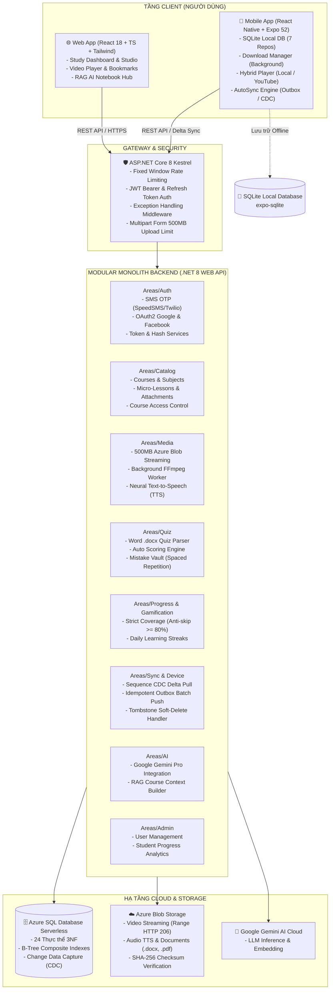

# 🎓 Microlearning - Nền Tảng Vi Học Tập Thông Minh & Ngoại Tuyến (Offline-First)

<p align="center">
  
  
  
  
  
  
  
</p>

<p align="center">
  <b>Hệ thống học tập vi mô đa nền tảng (Web & Mobile) với kiến trúc Ngoại tuyến đích thực (Offline-First), trình phát video lai thông minh, chống gian lận và trợ lý gia sư trí tuệ nhân tạo (RAG Notebook).</b>
</p>

<p align="center">
  <a href="https://ashy-grass-0bf212c00.3.azurestaticapps.net/" target="_blank">
    
  </a>
</p>

---

## 📌 Mục Lục

- [1. Giới Thiệu Dự Án](#-1-giới-thiệu-dự-án)
- [2. Tính Năng Nổi Bật](#-2-tính-năng-nổi-bật)
- [3. Kiến Trúc Hệ Thống](#-3-kiến-trúc-hệ-thống)
- [4. Mô Hình Cơ Sở Dữ Liệu (CSDL)](#-4-mô-hình-cơ-sở-dữ-liệu-csdl)
- [5. Công Nghệ Sử Dụng (Tech Stack)](#-5-công-nghệ-sử-dụng-tech-stack)
- [6. Cấu Trúc Thư Mục](#-6-cấu-trúc-thư-mục)
- [7. Hướng Dẫn Khởi Chạy (Quick Start)](#-7-hướng-dẫn-khởi-chạy-quick-start)
- [8. Danh Mục API Endpoints](#-8-danh-mục-api-endpoints)
- [9. Bảo Mật Hệ Thống](#-9-bảo-mật-hệ-thống)
- [10. Đóng Góp & Tác Giả](#-10-đóng-góp--tác-giả)

---

## 🌟 1. Giới Thiệu Dự Án

Trong thời đại số, người học thường xuyên đối mặt với hai rào cản lớn: **"Quá tải thông tin"** và **"Thiếu hụt thời gian"**. Các bài giảng truyền thống kéo dài từ 45 - 90 phút gây cảm giác nản lòng và khó tiếp thu. Ngoài ra, việc học trực tuyến thường bị gián đoạn ở những nơi có kết nối mạng kém hoặc chập chờn.

**Microlearning** được xây dựng nhằm giải quyết triệt để các thách thức trên:
1. **Triết lý Vi học tập (Microlearning Model):** Kiến thức được phân rã thành các bài học ngắn gọn từ **3 đến 7 phút**, tập trung giải quyết đúng 1 mục tiêu kiến thức cụ thể.
2. **Kiến trúc Ngoại tuyến Đích thực (True Offline-First):** Ứng dụng di động tích hợp cơ sở dữ liệu **SQLite** cục bộ. Học viên có thể tải bài giảng về thiết bị, học tập, xem video sắc nét và làm bài trắc nghiệm ngay cả khi hoàn toàn mất kết nối Internet. Khi có mạng trở lại, hệ thống sẽ tự động đồng bộ hai chiều (Delta Sync) ngầm.
3. **Gia sư Trí Tuệ Nhân Tạo RAG (Smart Notebook Hub):** Trợ lý AI tích hợp mô hình **Google Gemini Pro** tự động đọc hiểu và bóc tách tài liệu bài giảng (.docx, .doc, .pdf) để giải đáp thắc mắc chuyên sâu theo đúng giáo trình của thầy cô.

---

## 🚀 2. Tính Năng Nổi Bật

### 📱 2.1. Đột Phá Ngoại Tuyến Di Động (Mobile Offline-First)
- **SQLite Cục Bộ (7 Repositories):** Toàn bộ danh mục khóa học, bài học, ngân hàng câu hỏi, tiến độ học và bookmark được lưu trữ trực tiếp trên thiết bị (`expo-sqlite`).
- **Bộ Quản Lý Tải Về (Download Manager):** Hỗ trợ tải bài học và video về bộ nhớ máy với khả năng tạm dừng/tiếp tục (pause/resume). Tự động nhận diện và ẩn nút tải với video liên kết ngoài (YouTube) để bảo vệ bộ nhớ máy.
- **Động Cơ Đồng Bộ Tự Động Ngầm (autoSyncEngine):** Lắng nghe trạng thái kết nối mạng của thiết bị; tự động đẩy dữ liệu ngoại tuyến (Outbox Batch Push) lên máy chủ và kéo dữ liệu mới (Sequence Delta Pull) mà không cần người dùng thao tác.

### 🎬 2.2. Trình Phát Video Lai Thông Minh (Hybrid Video Player)
- **Đa Nguồn Phát Tự Động:** Phát mượt mà video lưu trữ đám mây **Azure Blob Storage** và liên kết **YouTube IFrame** thông qua WebView tùy biến (sửa hoàn toàn lỗi origin 152 của Google).
- **Chống Gian Lận Tua Nhanh (Strict Coverage Strategy):** Bắt buộc học viên phải theo dõi thực tế $\ge 80\%$ thời lượng bài giảng mới được tính là hoàn thành.
- **Đánh Dấu Mốc Thời Gian (Video Bookmarks):** Cho phép học viên lưu lại những giây quan trọng kèm ghi chú cá nhân để xem lại tức thì.

### 🧠 2.3. Trợ Lý AI Sổ Tay & Trích Xuất Tài Liệu (RAG AI Notebook)
- **Bộ Trích Xuất Toàn Năng (Document Extractor):** Tự động đọc và bóc tách nội dung văn bản từ các tệp Word (.docx qua Mammoth XML, .doc qua UTF-16LE Binary Parser), PDF và TXT từ cả Azure Blob lẫn bộ nhớ máy.
- **Cơ Chế Phục Hồi Tự Động (Auto-Hydration):** Khi học viên đặt câu hỏi, AI tự động quét và nạp lại văn bản thực tế của các tài liệu cũ chưa có nội dung chữ, học viên không cần gỡ ra gắn lại.
- **Dự Phòng Trực Tiếp (Direct Gemini Fallback):** Client tích hợp bộ gọi Gemini trực tiếp đảm bảo AI luôn phản hồi thông minh kể cả khi máy chủ proxy tạm thời bận.

### 📝 2.4. Soạn Đề Thi Trắc Nghiệm Tự Động Từ Word (.docx)
- Giảng viên chỉ cần kéo thả tệp Word soạn sẵn lên hệ thống.
- Động cơ phân tích cú pháp tự động nhận diện câu hỏi, các phương án trả lời A/B/C/D và đáp án đúng, tự động điền vào ngân hàng đề thi trong 1 giây.

### 🔒 2.5. Két Câu Hỏi Sai (Mistake Vault)
- Ứng dụng phương pháp **Lặp lại ngắt quãng (Spaced Repetition)**: Mọi câu hỏi trắc nghiệm làm sai được tự động lưu vào két sắt cá nhân.
- Khuyến khích học viên ôn luyện và làm lại bài kiểm tra cho đến khi nắm vững kiến thức (`IsResolved = true`).

### 🔥 2.6. Trò Chơi Hóa & Động Lực (Gamification & Streak)
- Theo dõi chuỗi ngày học tập liên tục (User Streak) với ngọn lửa hoạt động hàng ngày.
- Bảng xếp hạng và vinh danh học viên chuyên cần.

### 📊 2.7. Bảng Phân Tích Học Tập (Student Progress Analytics)
- Bảng điều khiển thời gian thực dành cho Quản trị viên và Giảng viên theo dõi tỷ lệ hoàn thành, điểm trung bình quiz, phát hiện học viên có nguy cơ bỏ dở để hỗ trợ kịp thời.

---

## 🏗️ 3. Kiến Trúc Hệ Thống



---

## 🗄️ 4. Mô Hình Cơ Sở Dữ Liệu (CSDL)

Hệ thống quản lý **24 bảng dữ liệu** được thiết kế chuẩn hóa bậc 3 (3NF) trên Azure SQL Database Serverless:

| Nhóm Chức Năng | Tên Thực Thể (Entity) | Vai Trò & Nghiệp Vụ Cốt Lõi |
| :--- | :--- | :--- |
| **Xác thực & Bảo mật** | `Accounts`, `RefreshTokens`, `OtpVerifications` | Quản lý định danh người dùng (Identity), khóa tài khoản khi bị dò mã, duy trì phiên bằng mã băm SHA-256 và lưu mã OTP SMS (hạn 5 phút). |
| **Cấu trúc Đào tạo** | `Courses`, `Subjects`, `Lessons`, `LessonAttachments` | Cây đào tạo vi mô phân cấp; lưu trữ đường dẫn video, tài liệu đính kèm trên Azure Blob và phiên bản đồng bộ `Version`. |
| **Đa phương tiện & TTS** | `MediaAssets`, `NarrationScripts`, `MediaJobs` | Quản lý tệp nhị phân, mã băm Checksum, kịch bản thuyết minh Text-to-Speech và hàng đợi xử lý ngầm FFmpeg. |
| **Đánh giá & Trắc nghiệm**| `Quizzes`, `Questions`, `QuizOptions`, `QuizAttempts`, `QuizAnswers`, `QuizAnswerOptions` | Hệ thống trắc nghiệm gắn liền từng bài học, chấm điểm tự động trên server, hỗ trợ câu hỏi nhiều đáp án đúng và mã `ClientAttemptId` chống nộp trùng khi Offline. |
| **Tiến độ & Chống gian lận**| `LessonProgresses`, `UserStreaks` | Lưu trữ phần trăm hoàn thành, số giây đã học; áp dụng chiến lược chống tua video $\ge 80\%$ và duy trì ngọn lửa học tập hàng ngày. |
| **Đồng bộ Ngoại tuyến** | `Devices`, `ContentChanges`, `SyncOperations` | Lưu thông tin thiết bị di động, bảng ghi nhận thay đổi dữ liệu (CDC Sequence) phục vụ Delta Sync và hàng đợi thao tác ngoại tuyến (Outbox Idempotency). |
| **Cá nhân hóa & Ôn tập** | `UserQuizMistakes`, `UserMediaBookmarks`, `UserFavoriteSubjects`, `UserCourseAccesses` | Két câu hỏi sai (Mistake Vault), đánh dấu mốc thời gian video kèm ghi chú, danh sách môn học yêu thích và phân quyền khóa học trả phí. |

---

## 💻 5. Công Nghệ Sử Dụng (Tech Stack)

### Backend (.NET 8 Web API)
- **Framework:** ASP.NET Core 8 Web API (.NET 8 LTS)
- **ORM:** Entity Framework Core 8 (EF Core 8)
- **Database:** Azure SQL Database Serverless / SQL Server 2022
- **Storage:** Azure Blob Storage SDK v12
- **Security:** ASP.NET Core Identity, JWT Bearer Token, HMAC-SHA256, BCrypt, Kestrel Rate Limiting
- **Multimedia:** FFmpeg CLI Integration, Microsoft Neural Text-to-Speech
- **Container:** Docker Multi-stage Build, Docker Compose

### Frontend Web
- **Core:** React 18, TypeScript, Vite
- **Styling:** Tailwind CSS, Lucide React Icons
- **Data Fetching & Cache:** TanStack Query (React Query v5), IndexedDB Local Fallback
- **Media:** Custom Video Player với Volume Slider, Bookmark markers và YouTube IFrame API
- **Document Parsing:** Mammoth.js (giải mã OpenXML .docx trích xuất nội dung văn bản)

### Mobile App
- **Core:** React Native, Expo SDK 52, Expo Router v4
- **Database:** `expo-sqlite` (Local Database Engine)
- **Local Storage:** `expo-file-system`, `expo-secure-store` (mã hóa phần cứng Keychain/Keystore)
- **Video & Media:** Expo Video Player, `react-native-webview`, `react-native-youtube-iframe`
- **State Management:** Zustand, NetInfo Network Event Listener

---

## 📁 6. Cấu Trúc Thư Mục

```
MicroLearning/
├── Areas/                             # Các phân hệ nghiệp vụ Backend (.NET 8)
│   ├── Admin/                         # Quản trị & Thống kê học tập (Analytics)
│   ├── AI/                            # Trợ lý AI Assistant (Google Gemini & RAG)
│   ├── Auth/                          # Xác thực, OTP SMS, OAuth2, JWT & RefreshToken
│   ├── Catalog/                       # Khóa học, Môn học, Bài học vi mô, Tài liệu
│   ├── Common/                        # HealthCheck, Middleware bắt lỗi tập trung
│   ├── Device/                        # Quản lý thiết bị di động học viên
│   ├── Enrollment/                    # Ghi danh khóa học
│   ├── Gamification/                  # Chuỗi học tập Streak
│   ├── Media/                         # Tải lên Azure Blob 500MB, FFmpeg & TTS Worker
│   ├── Progress/                      # Tiến độ xem bài & Thuật toán chống tua
│   ├── Quiz/                          # Trắc nghiệm, Parser đề từ Word & Mistake Vault
│   └── Sync/                          # Động cơ đồng bộ Offline (CDC & Outbox Push)
├── Model/                             # DbContext trung tâm (24 Entities & DTOs)
├── client/                            # Ứng dụng Web (React 18 + TypeScript + Vite)
│   └── src/
│       ├── components/                # Studio, Player, Dashboard, Notebook Hub
│       ├── hooks/                     # Custom hooks (useNotebook, useLessonSearch)
│       ├── services/                  # API clients, Gemini client, IndexedDB
│       └── utils/                     # Document Extractor (.docx, .doc, .pdf)
├── mobile/                            # Ứng dụng Mobile (React Native + Expo SDK 52)
│   ├── app/                           # Expo Router (tabs: Home, Catalog, Downloads, AI)
│   └── src/
│       ├── components/player/         # Hybrid Video Player (Local & YouTube)
│       ├── db/repositories/           # 7 SQLite Repositories cho Offline-First
│       ├── services/                  # DownloadManager, AutoSyncEngine, Gemini
│       └── utils/                     # Mobile Document Extractor
├── Report/                            # Báo cáo chuyên sâu dự án (.docx)
├── docker-compose.yml                 # Khởi chạy cụm SQL Server 2022 & Backend API
├── Dockerfile                         # Đóng gói Backend API với FFmpeg runtime
└── README.md                          # Tài liệu hướng dẫn chính thức của dự án
```

---

## ⚡ 7. Hướng Dẫn Khởi Chạy (Quick Start)

### Yêu Cầu Môi Trường (Prerequisites)
- [.NET 8 SDK](https://dotnet.microsoft.com/download/dotnet/8.0)
- [Node.js 18+](https://nodejs.org/)
- [Docker & Docker Compose](https://www.docker.com/) (Tùy chọn nếu chạy container)
- [Expo Go App](https://expo.dev/go) trên thiết bị di động Android hoặc iOS

---

### Cách 1: Khởi Chạy Nhanh Bằng Docker Compose (Khuyến nghị cho Backend)
Khởi chạy đồng thời cơ sở dữ liệu SQL Server 2022 và máy chủ Backend API chỉ bằng **1 lệnh duy nhất**:
```bash
docker compose up -d --build
```
- API Endpoint: `http://localhost:5124`
- Swagger UI tài liệu: `http://localhost:5124/swagger`
- Cụm CSDL SQL Server: `localhost:1433` (Tài khoản: `sa` / Mật khẩu: `Microlearning@2026!`)

---

### Cách 2: Khởi Chạy Thủ Công Từng Phân Hệ

#### 1. Khởi chạy Backend (.NET 8 Web API)
```bash
# Phục hồi các gói thư viện NuGet
dotnet restore

# Biên dịch kiểm tra mã nguồn
dotnet build

# Khởi chạy ứng dụng Web API
dotnet run
```
> Hệ thống tích hợp cơ chế tự động Migration và Seeding tài khoản Admin/Giáo viên mẫu ngay khi khởi động.

#### 2. Khởi chạy Ứng dụng Web (React 18 + Vite)
```bash
cd client
npm install
npm run dev
```
> Truy cập giao diện Web tại: `http://localhost:5173`

#### 3. Khởi chạy Ứng dụng Mobile (React Native Expo)
```bash
cd mobile
npm install
npx expo start
```
> Quét mã QR hiển thị trên màn hình bằng ứng dụng **Expo Go** (Android) hoặc Camera (iOS) để trải nghiệm trực tiếp trên điện thoại.

---

## 📡 8. Danh Mục API Endpoints

Hệ thống cung cấp đầy đủ tài liệu tương tác qua Swagger UI tại `/swagger`. Dưới đây là các cụm endpoint chính:

| Nhóm API | Tuyến Đường (Route) | Phương Thức | Mô Tả Nghiệp Vụ |
| :--- | :--- | :---: | :--- |
| **Auth** | `/api/auth/send-otp` | `POST` | Gửi mã OTP SMS về điện thoại (Rate limit 5 req/phút). |
| | `/api/auth/verify-otp` | `POST` | Xác minh mã OTP và cấp phát JWT token + Refresh token. |
| | `/api/auth/login` | `POST` | Đăng nhập tài khoản bằng số điện thoại và mật khẩu. |
| | `/api/auth/google`, `/facebook` | `POST` | Đăng nhập một chạm thông qua OAuth2 Access Token. |
| **Catalog** | `/api/catalog/courses` | `GET`, `POST` | Xem danh sách khóa học và tạo mới khóa học vi mô. |
| | `/api/catalog/lessons/{id}` | `GET`, `PUT` | Lấy chi tiết bài giảng, cập nhật video URL và thời lượng. |
| | `/api/catalog/lessons/{id}/attachments` | `POST` | Tải tệp tài liệu giảng dạy đính kèm (.docx, .doc, .pdf). |
| **Media** | `/api/media/upload-video` | `POST` | Tải video dung lượng lớn (lên tới 500 MB) lên Azure Blob. |
| | `/api/media/stream/{id}` | `GET` | Phát luồng video chuẩn HTTP 206 Partial Content. |
| **Quiz** | `/api/quiz/lesson/{lessonId}` | `GET` | Lấy đề kiểm tra trắc nghiệm gắn liền với bài học. |
| | `/api/quiz/attempt` | `POST` | Nộp bài làm trắc nghiệm, tính điểm tự động và cập nhật Mistake Vault. |
| | `/api/quiz/mistakes` | `GET` | Lấy danh sách các câu hỏi làm sai trong Két câu hỏi cá nhân. |
| **Progress** | `/api/progress/video-heartbeat` | `POST` | Gửi nhịp tim xem video với thuật toán kiểm tra độ bao phủ $\ge 80\%$. |
| | `/api/gamification/streak` | `GET` | Lấy số ngày học liên tục (Streak) của người dùng hiện tại. |
| **Sync** | `/api/sync/delta-pull` | `GET` | Lấy dữ liệu thay đổi (CDC) kể từ `afterSequence` phục vụ Mobile. |
| | `/api/sync/batch-push` | `POST` | Đẩy hàng loạt thao tác ngoại tuyến (Outbox) lên máy chủ trong 1 Transaction. |
| **AI Assistant** | `/api/aiassistant/ask` | `POST` | Hỏi đáp trợ lý AI RAG dựa trên ngữ cảnh tài liệu khóa học đã trích xuất. |
| **Admin** | `/api/admin/student-analytics` | `GET` | Trích xuất báo cáo phân tích học tập học sinh trực quan thời gian thực. |

---

## 🛡️ 9. Bảo Mật Hệ Thống

1. **Xác thực Đa Tầng:**
   - JWT Access Token thời hạn 60 phút ký bằng thuật toán HMAC-SHA256.
   - Refresh Token và mã OTP được băm một chiều SHA-256 trong CSDL, tự động thu hồi ngay khi đăng xuất.
2. **Kiểm Soát Tần Suất Truy Cập (Kestrel Rate Limiting):**
   - Áp dụng các chính sách Fixed Window Rate Limiter chặt chẽ trên các endpoint nhạy cảm: `SendOtpPolicy` (5 req/phút), `VerifyOtpPolicy` (10 req/phút), `AuthPolicy` (20 req/phút), `SyncPolicy` (60 req/phút) để ngăn chặn tấn công từ chối dịch vụ (DDoS) và lạm dụng cước phí SMS.
3. **Toàn Vẹn Dữ Liệu Tệp Đa Phương Tiện:**
   - Mọi video và tài liệu tải lên Azure Blob đều được tính toán mã băm SHA-256 Checksum lưu vào CSDL để bảo vệ chống lại việc tệp tin bị hư hỏng hoặc can thiệp trái phép.
4. **Bảo Mật Phần Cứng Thiết Bị Đầu Cuối:**
   - Ứng dụng di động lưu trữ token nhạy cảm trong vùng nhớ phần cứng an toàn (**iOS Keychain** và **Android Keystore**) thông qua `expo-secure-store`, tuyệt đối không lưu dạng Plaintext trong bộ nhớ thông thường.

---

## 👥 10. Đóng Góp & Tác Giả

- **Trưởng Nhóm Kỹ Thuật & Kiến Trúc Hệ Thống (Lead Architect & Fullstack Developer):** Nguyễn Minh Tân
- **Đội Ngũ Kỹ Sư Phát Triển:** Đội ngũ Dự án Microlearning
- **Tài Liệu Chi Tiết Bàn Giao:** Xem thêm tệp văn bản Word đầy đủ tại [Report/Bao_Cao_Du_An_Microlearning.docx](file:///d:/Web%20App/MicroLearning/Report/Bao_Cao_Du_An_Microlearning.docx)

---

<p align="center">
  <b>⭐ Nếu bạn thấy dự án hữu ích, hãy tặng 1 Star trên GitHub để ủng hộ đội ngũ phát triển! ⭐</b>
</p>
