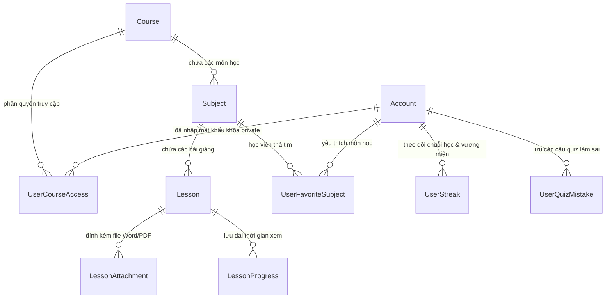

# ĐẶC TẢ KIẾN TRÚC & THIẾT KẾ KỸ THUẬT NÂNG CẤP HỆ THỐNG (10 TÍNH NĂNG)
## Tuân thủ nghiêm ngặt: SOLID, OOP, Thin Controller, Thin Service, Clean Architecture

> **Dự án:** Nền tảng Học tập Trực tuyến Microlearning  
> **Phiên bản tài liệu:** v2.0 - Production Ready  
> **Nhánh phát triển:** `FE` (Front-End & Fullstack Integration)  
> **Mục tiêu:** Bản đặc tả chi tiết kiến trúc hướng đối tượng (OOP) và các nguyên lý SOLID, phân tách rõ ràng trách nhiệm giữa Controller (siêu mỏng), Service (tinh gọn, chuyên trách), Domain Entities và Giao diện người dùng.

---

## 1. NGUYÊN TẮC THIẾT KẾ CỐT LÕI (CORE ARCHITECTURAL PRINCIPLES)

### 1.1. Chuẩn mực SOLID trong hệ thống:
1. **S - Single Responsibility Principle (Đơn trách nhiệm):**
   - Mỗi Controller chỉ tiếp nhận request và trả về HTTP response.
   - Mỗi Service chỉ giải quyết duy nhất một ngữ cảnh nghiệp vụ (vd: `IVideoAntiCheatService` chỉ tính toán tính hợp lệ của việc xem video, không kiêm nhiệm lưu điểm Quiz hay gửi email).
2. **O - Open/Closed Principle (Mở rộng, đóng sửa đổi):**
   - Mở rộng các chiến lược kiểm tra hoàn thành video qua `IVideoCompletionStrategy` mà không sửa logic cũ.
   - Mở rộng kho lưu trữ tệp tin đính kèm qua `IAttachmentStorageProvider` (Azure Blob, AWS S3, Local Disk).
3. **L - Liskov Substitution Principle (Thay thế Liskov):**
   - Mọi implementation của Storage Provider hoặc Hasher đều có thể thay thế lẫn nhau mà không làm gián đoạn Controller hoặc Use Case.
4. **I - Interface Segregation Principle (Phân tách giao diện):**
   - Không tạo Interface "khổng lồ" `ICourseService` chứa hàng chục phương thức. Tách thành: `ICourseQueryService`, `ICourseCommandService`, `ICourseAccessService`, `ICourseAnalyticsService`.
5. **D - Dependency Inversion Principle (Đảo ngược phụ thuộc):**
   - High-level modules (Controllers, UseCases) phụ thuộc vào abstraction (Interfaces). Toàn bộ được tiêm qua Constructor Dependency Injection.

### 1.2. Định nghĩa "Thin Controller" (Controller siêu mỏng):
- **Tuyệt đối CẤM:**
  - Viết logic nghiệp vụ, tính toán toán học, vòng lặp for/while trong Controller.
  - Gọi trực tiếp `DbContext` hoặc câu lệnh SQL trong Controller.
  - Xử lý mã hóa mật khẩu hoặc tính toán mã băm trong Controller.
- **Controller CHỈ ĐƯỢC PHÉP:**
  - Lấy `UserId` từ `ClaimsPrincipal`.
  - Validate cơ bản qua DataAnnotations hoặc FluentValidation.
  - Ủy thác cho Service tương ứng xử lý.
  - Ánh xạ kết quả trả về mã trạng thái HTTP chuẩn: `200 OK`, `201 Created`, `204 NoContent`, `400 BadRequest`, `401 Unauthorized`, `403 Forbidden`, `404 NotFound`.

### 1.3. Định nghĩa "Thin Service" (Dịch vụ tinh gọn):
- Tránh tạo các lớp "God Service" (Service ôm đồm hàng nghìn dòng mã).
- Mỗi Service tập trung vào một nhiệm vụ duy nhất (Single Use-Case hoặc Focused Domain Service).
- Logic kiểm tra hợp lệ được ủy thác cho các `IValidationRule<T>`. Logic lưu trữ tệp ủy thác cho `IStorageProvider`.

---

## 2. THIẾT KẾ CƠ SỞ DỮ LIỆU & EF CORE DOMAIN ENTITIES



### 2.1. Chi tiết các bảng bổ sung & sửa đổi trong CSDL:

#### 1. Bảng `Courses` (Bổ sung cột phân quyền Private):
```sql
ALTER TABLE Courses ADD IsPrivate BIT NOT NULL DEFAULT 0;
ALTER TABLE Courses ADD AccessPasswordHash NVARCHAR(256) NULL;
ALTER TABLE Courses ADD PasswordVersion INT NOT NULL DEFAULT 1;
```

#### 2. Bảng `UserCourseAccesses` (Lưu quyền vào khóa học Private):
```sql
CREATE TABLE UserCourseAccesses (
    AccountId NVARCHAR(450) NOT NULL,
    CourseId INT NOT NULL,
    UnlockedPasswordVersion INT NOT NULL,
    UnlockedAt DATETIME2 NOT NULL DEFAULT GETUTCDATE(),
    CONSTRAINT PK_UserCourseAccesses PRIMARY KEY (AccountId, CourseId),
    CONSTRAINT FK_UserCourseAccesses_Account FOREIGN KEY (AccountId) REFERENCES AspNetUsers(Id) ON DELETE CASCADE,
    CONSTRAINT FK_UserCourseAccesses_Course FOREIGN KEY (CourseId) REFERENCES Courses(Id) ON DELETE CASCADE
);
```

#### 3. Bảng `LessonAttachments` (Quản lý file Word, PDF đính kèm):
```sql
CREATE TABLE LessonAttachments (
    Id INT IDENTITY(1,1) PRIMARY KEY,
    LessonId INT NOT NULL,
    FileName NVARCHAR(255) NOT NULL,
    OriginalFileName NVARCHAR(255) NOT NULL,
    FileType NVARCHAR(20) NOT NULL,            -- 'PDF' | 'WORD'
    FileUrl NVARCHAR(500) NOT NULL,
    FileSizeBytes BIGINT NOT NULL,
    Sha256Checksum NVARCHAR(64) NOT NULL,
    CreatedAt DATETIME2 NOT NULL DEFAULT GETUTCDATE(),
    CONSTRAINT FK_LessonAttachments_Lesson FOREIGN KEY (LessonId) REFERENCES Lessons(Id) ON DELETE CASCADE
);
CREATE INDEX IX_LessonAttachments_LessonId ON LessonAttachments(LessonId);
```

#### 4. Bảng `LessonProgresses` (Bổ sung theo dõi dải xem chống tua):
```sql
ALTER TABLE LessonProgresses ADD WatchedCoveragePercent FLOAT NOT NULL DEFAULT 0.0;
ALTER TABLE LessonProgresses ADD SkippedRatio FLOAT NOT NULL DEFAULT 0.0;
ALTER TABLE LessonProgresses ADD IsEligibleForCompletion BIT NOT NULL DEFAULT 1;
```

#### 5. Bảng `UserStreaks` (Theo dõi chuỗi ngày học & Vương miện):
```sql
CREATE TABLE UserStreaks (
    AccountId NVARCHAR(450) PRIMARY KEY,
    CurrentStreak INT NOT NULL DEFAULT 0,
    LongestStreak INT NOT NULL DEFAULT 0,
    LastActiveDate DATE NULL,
    HasMasterCrown BIT NOT NULL DEFAULT 0,
    CrownAwardedAt DATETIME2 NULL,
    UpdatedAt DATETIME2 NOT NULL DEFAULT GETUTCDATE(),
    CONSTRAINT FK_UserStreaks_Account FOREIGN KEY (AccountId) REFERENCES AspNetUsers(Id) ON DELETE CASCADE
);
```

#### 6. Bảng `UserQuizMistakes` (Sổ tay lưu các câu làm sai):
```sql
CREATE TABLE UserQuizMistakes (
    Id BIGINT IDENTITY(1,1) PRIMARY KEY,
    AccountId NVARCHAR(450) NOT NULL,
    QuestionId INT NOT NULL,
    QuizId INT NOT NULL,
    LessonId INT NOT NULL,
    SelectedOptionId INT NOT NULL,
    FailedCount INT NOT NULL DEFAULT 1,
    IsResolved BIT NOT NULL DEFAULT 0,
    LastFailedAt DATETIME2 NOT NULL DEFAULT GETUTCDATE(),
    ResolvedAt DATETIME2 NULL,
    CONSTRAINT FK_UserQuizMistakes_Account FOREIGN KEY (AccountId) REFERENCES AspNetUsers(Id) ON DELETE CASCADE,
    CONSTRAINT FK_UserQuizMistakes_Question FOREIGN KEY (QuestionId) REFERENCES Questions(Id) ON DELETE CASCADE,
    CONSTRAINT FK_UserQuizMistakes_Quiz FOREIGN KEY (QuizId) REFERENCES Quizzes(Id) ON DELETE NO ACTION
);
CREATE INDEX IX_UserQuizMistakes_User_Resolved ON UserQuizMistakes(AccountId, IsResolved);
```

#### 7. Bảng `UserFavoriteSubjects` (Môn học yêu thích):
```sql
CREATE TABLE UserFavoriteSubjects (
    AccountId NVARCHAR(450) NOT NULL,
    SubjectId INT NOT NULL,
    CreatedAt DATETIME2 NOT NULL DEFAULT GETUTCDATE(),
    CONSTRAINT PK_UserFavoriteSubjects PRIMARY KEY (AccountId, SubjectId),
    CONSTRAINT FK_UserFavoriteSubjects_Account FOREIGN KEY (AccountId) REFERENCES AspNetUsers(Id) ON DELETE CASCADE,
    CONSTRAINT FK_UserFavoriteSubjects_Subject FOREIGN KEY (SubjectId) REFERENCES Subjects(Id) ON DELETE CASCADE
);
```

---

## 3. THIẾT KẾ CHI TIẾT 10 TÍNH NĂNG (THEO CHUẨN SOLID & THIN ARCHITECTURE)

---

### TÍNH NĂNG 1: ĐĂNG TẢI TÀI LIỆU BÀI GIẢNG (WORD, PDF)

#### A. Kiến trúc Backend (.NET 8):
- **Phân tách Interface (ISP & DIP):**
  ```csharp
  public interface IAttachmentStorageProvider
  {
      Task<UploadFileResult> UploadAsync(Stream stream, string fileName, string contentType, CancellationToken ct);
      Task DeleteAsync(string fileUrl, CancellationToken ct);
  }

  public interface ILessonAttachmentService
  {
      Task<LessonAttachmentDto> AddAttachmentAsync(int lessonId, IFormFile file, CancellationToken ct);
      Task<bool> DeleteAttachmentAsync(int attachmentId, CancellationToken ct);
      Task<IReadOnlyList<LessonAttachmentDto>> GetAttachmentsByLessonIdAsync(int lessonId, CancellationToken ct);
  }
  ```
- **Thin Controller (`Areas/Catalog/Controllers/LessonAttachmentsController.cs`):**
  ```csharp
  [ApiController]
  [Route("api/lessons/{lessonId:int}/attachments")]
  public class LessonAttachmentsController : ControllerBase
  {
      private readonly ILessonAttachmentService _attachmentService;
      public LessonAttachmentsController(ILessonAttachmentService attachmentService) => _attachmentService = attachmentService;

      [HttpGet]
      public async Task<IActionResult> GetByLesson(int lessonId, CancellationToken ct) 
          => Ok(await _attachmentService.GetAttachmentsByLessonIdAsync(lessonId, ct));

      [HttpPost]
      [Authorize(Roles = "Admin,Teacher")]
      public async Task<IActionResult> Upload(int lessonId, [FromForm] IFormFile file, CancellationToken ct)
      {
          var result = await _attachmentService.AddAttachmentAsync(lessonId, file, ct);
          return CreatedAtAction(nameof(GetByLesson), new { lessonId }, result);
      }

      [HttpDelete("{attachmentId:int}")]
      [Authorize(Roles = "Admin,Teacher")]
      public async Task<IActionResult> Delete(int attachmentId, CancellationToken ct)
      {
          await _attachmentService.DeleteAttachmentAsync(attachmentId, ct);
          return NoContent();
      }
  }
  ```

#### B. Phía Frontend React Web:
- **UI Studio:** Khu vực kéo thả hỗ trợ `.pdf`, `.docx`, `.doc`. Giới hạn kích thước tối đa 50MB/file.
- **UI Học viên:** Tab "Tài liệu" ngay dưới video. Đọc file PDF trực quan bằng `<iframe src="{pdfUrl}" />` hoặc tải về bằng 1 click.

---

### TÍNH NĂNG 2: CHỐNG GIAN LẬN TUA VIDEO (> 30% KHÔNG TÍNH HOÀN THÀNH)

#### A. Thuật toán Hợp nhất các đoạn thời gian xem (Interval Union Algorithm):
- **Mô hình toán học:** Khi người học phát video, client ghi nhận mảng các đoạn đã xem: $[[t_1, t_2], [t_3, t_4], \dots]$.
- Thuật toán `MergeIntervals` hợp nhất các đoạn chồng lấn:
  $$\text{WatchedCoverage} = \sum (\text{End}_i - \text{Start}_i)$$
  $$\text{SkippedRatio} = 1.0 - \frac{\text{WatchedCoverage}}{\text{Duration}}$$
- **Điều kiện hoàn thành:** $\text{SkippedRatio} \le 0.30$ (tức là đã thực xem ít nhất $70\%$ tổng thời lượng).

#### B. Kiến trúc Backend:
- **Strategy Pattern (OCP):**
  ```csharp
  public interface IVideoCompletionStrategy
  {
      VideoCompletionResult Evaluate(double totalDuration, IReadOnlyList<TimeRangeDto> watchedIntervals, double currentPosition);
  }

  public class StrictCoverageVideoCompletionStrategy : IVideoCompletionStrategy
  {
      private const double MAX_ALLOWED_SKIP_RATIO = 0.30; // Tối đa 30% bị tua bỏ
      public VideoCompletionResult Evaluate(double totalDuration, IReadOnlyList<TimeRangeDto> watchedIntervals, double currentPosition)
      {
          // Thuật toán gộp các khoảng xem (Interval Union)
          var coverageSeconds = IntervalCalculator.CalculateUnionLength(watchedIntervals);
          var coverageRatio = totalDuration > 0 ? coverageSeconds / totalDuration : 0;
          var skippedRatio = 1.0 - coverageRatio;
          bool isEligible = skippedRatio <= MAX_ALLOWED_SKIP_RATIO;

          return new VideoCompletionResult(coverageRatio, skippedRatio, isEligible);
      }
  }
  ```
- **Thin Controller (`Areas/Progress/Controllers/ProgressController.cs`):**
  ```csharp
  [HttpPost("video-coverage")]
  [Authorize]
  public async Task<IActionResult> RecordVideoProgress([FromBody] RecordVideoCoverageRequest request, CancellationToken ct)
  {
      var userId = User.GetUserId();
      var result = await _videoProgressService.RecordProgressWithCoverageAsync(userId, request, ct);
      return Ok(result);
  }
  ```

---

### TÍNH NĂNG 3: TÌM KIẾM BÀI HỌC TRONG KHÓA HỌC / MÔN HỌC

#### A. Phía Frontend Web:
- **Custom Hook `useLessonSearch.ts`:**
  - Chuẩn hóa tiếng Việt không dấu (Remove Vietnamese diacritics).
  - Tự động debounce 250ms tránh lag UI khi người dùng gõ phím.
  - Tìm kiếm kết hợp theo cả `Lesson.Title` và `Lesson.Description`.
  - Tự động mở (expand) các môn học có bài giảng trùng khớp từ khóa.

---

### TÍNH NĂNG 4: THU GỌN / MỞ RỘNG DANH SÁCH BÀI HỌC THEO MÔN HỌC (ACCORDION)

#### A. Phía Frontend Web:
- **State Pattern Component:**
  - Quản lý danh sách các môn đang mở: `expandedSubjectIds: Set<number>`.
  - Hỗ trợ thao tác 1 chạm: **"Mở tất cả" (Expand All)** và **"Thu gọn tất cả" (Collapse All)**.
  - Tự động cuộn và mở sẵn môn học chứa bài giảng mà học viên đang phát hiện tại.

---

### TÍNH NĂNG 5: NÚT TIẾN / LÙI TRANG WEB (IN-APP NAVIGATION CONTROLS)

#### A. Phía Frontend Web:
- **Custom Hook `useAppHistoryNavigation.ts`:**
  - Đóng gói `useNavigate()` của React Router DOM.
  - Cung cấp: `canGoBack: boolean`, `canGoForward: boolean`, `goBack()`, `goForward()`.
  - Tránh tình trạng back văng khỏi web khi đang ở màn hình đầu tiên.
  - Lưu trữ Breadcrumb: `Trang chủ > Khóa học > Môn học > Bài học`.

---

### TÍNH NĂNG 6: KHÓA HỌC PUBLIC VS PRIVATE (CÓ PASSWORD & TỰ ĐỘNG THU HỒI KHI ĐỔI PASS)

#### A. Kiến trúc Backend:
- **Interface Chuyên trách (ISP):**
  ```csharp
  public interface ICourseAccessService
  {
      Task<CourseAccessCheckResult> CheckAccessAsync(string userId, int courseId, CancellationToken ct);
      Task<bool> UnlockCourseWithPasswordAsync(string userId, int courseId, string plainPassword, CancellationToken ct);
      Task<bool> UpdateCoursePrivacyAsync(int courseId, bool isPrivate, string? newPassword, CancellationToken ct);
  }
  ```
- **Xử lý Corner-Case đổi mật khẩu:**
  - Khi Giáo viên đổi mật khẩu trong Studio: `Course.PasswordVersion = Course.PasswordVersion + 1`.
  - Khi học viên truy cập: So sánh `UserCourseAccess.UnlockedPasswordVersion` với `Course.PasswordVersion`.
  - Nếu phiên bản cũ hơn ➡️ Quyền truy cập tự động hết hiệu lực ➡️ Yêu cầu học viên nhập lại mật khẩu mới.

#### B. Thin Controller (`Areas/Catalog/Controllers/CourseAccessController.cs`):
```csharp
[ApiController]
[Route("api/courses/{courseId:int}/access")]
public class CourseAccessController : ControllerBase
{
    private readonly ICourseAccessService _accessService;
    public CourseAccessController(ICourseAccessService accessService) => _accessService = accessService;

    [HttpGet("check")]
    [Authorize]
    public async Task<IActionResult> CheckAccess(int courseId, CancellationToken ct) 
        => Ok(await _accessService.CheckAccessAsync(User.GetUserId(), courseId, ct));

    [HttpPost("unlock")]
    [Authorize]
    public async Task<IActionResult> Unlock(int courseId, [FromBody] UnlockCourseRequest request, CancellationToken ct)
    {
        var success = await _accessService.UnlockCourseWithPasswordAsync(User.GetUserId(), courseId, request.Password, ct);
        return success ? Ok(new { message = "Mở khóa thành công." }) : BadRequest(new { message = "Mật khẩu không chính xác." });
    }
}
```

---

### TÍNH NĂNG 7: GIÁNG VIÊN / ADMIN XEM TIẾN ĐỘ TOÀN BỘ HỌC VIÊN

#### A. Kiến trúc Backend:
- **Thin Query Service:**
  ```csharp
  public interface IStudentProgressAnalyticsService
  {
      Task<PagedResult<StudentProgressDetailDto>> GetCourseStudentsProgressAsync(int courseId, StudentProgressFilterDto filter, CancellationToken ct);
      Task<CourseOverviewMetricsDto> GetCourseMetricsOverviewAsync(int courseId, CancellationToken ct);
  }
  ```
- **Thin Controller (`Areas/Admin/Controllers/StudentProgressAnalyticsController.cs`):**
  ```csharp
  [ApiController]
  [Route("api/admin/courses/{courseId:int}/students-progress")]
  [Authorize(Roles = "Admin,Teacher")]
  public class StudentProgressAnalyticsController : ControllerBase
  {
      private readonly IStudentProgressAnalyticsService _analyticsService;
      public StudentProgressAnalyticsController(IStudentProgressAnalyticsService analyticsService) => _analyticsService = analyticsService;

      [HttpGet]
      public async Task<IActionResult> GetProgress(int courseId, [FromQuery] StudentProgressFilterDto filter, CancellationToken ct)
          => Ok(await _analyticsService.GetCourseStudentsProgressAsync(courseId, filter, ct));
  }
  ```

---

### TÍNH NĂNG 8: STREAK HỌC TẬP HÀNG NGÀY & VƯƠNG MIỆN HOÀNG GIA (MASTER CROWN)

#### A. Thuật toán Đếm Streak & Vương miện:
1. **Chu kỳ Streak:** Tính theo múi giờ `UTC+7` (00:00:00 đến 23:59:59).
   - Nếu hoàn thành bài đầu tiên trong ngày hôm nay:
     - Nếu `LastActiveDate == Hôm qua` ➡️ `CurrentStreak = CurrentStreak + 1`.
     - Nếu `LastActiveDate < Hôm qua` ➡️ `CurrentStreak = 1` (Bị đứt chuỗi).
     - Nếu `LastActiveDate == Hôm nay` ➡️ Giữ nguyên chuỗi.
2. **Quy tắc Vương miện (Master Crown):**
   - Xác định danh sách khóa học hợp lệ:
     $$\text{Khóa hợp lệ} = \{C \mid C.\text{IsPublished} = 1 \land (C.\text{IsPrivate} = 0 \lor C \in \text{KhóaPrivateĐãMởUnlock})\}$$
   - Tính tổng bài học của các khóa này ($T$) và số bài học viên đã hoàn thành ($C$).
   - Nếu $C = T$ (100% full bài) ➡️ Bật cờ `HasMasterCrown = true` (Hiển thị icon 👑).
   - Nếu giảng viên bổ sung thêm bài giảng hoặc khóa học mới ➡️ $C < T$ ➡️ Tự động hạ Vương miện, quay về đếm chuỗi Streak ngọn lửa 🔥!

#### B. Thin Service & Controller:
- `IUserStreakService`: `Task<UserStreakDto> RecordDailyLearningAsync(string userId, CancellationToken ct);`
- `StreakController`: `[HttpGet("my-streak")]` ➡️ Trả về Streak và trạng thái Crown.

---

### TÍNH NĂNG 9: SỔ TAY ÔN TẬP CÂU HỎI QUIZ LÀM SAI (MISTAKE REVIEW VAULT)

#### A. Kiến trúc Backend:
- **Tự động gom câu sai:** Khi học viên nộp bài thi Quiz tại `QuizService`, các câu hỏi có đáp án không trùng với `IsCorrect = true` sẽ được đưa vào bảng `UserQuizMistakes`.
- **Interface Chuyên trách:**
  ```csharp
  public interface IQuizMistakeVaultService
  {
      Task<IReadOnlyList<QuizMistakeItemDto>> GetMyMistakesAsync(string userId, CancellationToken ct);
      Task<QuizPracticeSessionDto> GenerateReviewSessionAsync(string userId, int? lessonId, CancellationToken ct);
      Task<MistakeAnswerResultDto> SubmitPracticeAnswerAsync(string userId, int mistakeId, int selectedOptionId, CancellationToken ct);
  }
  ```
- **Xóa khỏi sổ tay lỗi sai:** Khi học viên làm bài thi ôn tập và chọn đúng đáp án ➡️ Cập nhật `IsResolved = true`.

---

### TÍNH NĂNG 10: MÔN HỌC YÊU THÍCH (THẢ TIM & QUICK FAST-TRAVEL)

#### A. Kiến trúc Backend:
- **Interface Chuyên biệt:**
  ```csharp
  public interface IFavoriteSubjectService
  {
      Task<bool> ToggleFavoriteAsync(string userId, int subjectId, CancellationToken ct);
      Task<IReadOnlyList<FavoriteSubjectDto>> GetMyFavoritesAsync(string userId, CancellationToken ct);
  }
  ```
- **Thin Controller (`Areas/Catalog/Controllers/FavoriteSubjectsController.cs`):**
  ```csharp
  [ApiController]
  [Route("api/catalog/subjects")]
  [Authorize]
  public class FavoriteSubjectsController : ControllerBase
  {
      private readonly IFavoriteSubjectService _favoriteService;
      public FavoriteSubjectsController(IFavoriteSubjectService favoriteService) => _favoriteService = favoriteService;

      [HttpPost("{subjectId:int}/favorite")]
      public async Task<IActionResult> Toggle(int subjectId, CancellationToken ct) 
          => Ok(await _favoriteService.ToggleFavoriteAsync(User.GetUserId(), subjectId, ct));

      [HttpGet("favorites")]
      public async Task<IActionResult> GetMyFavorites(CancellationToken ct) 
          => Ok(await _favoriteService.GetMyFavoritesAsync(User.GetUserId(), ct));
  }
  ```

#### B. Phía Frontend Web:
- Nút thả tim ❤️ cạnh tiêu đề môn học với hiệu ứng nảy (Heart bounce animation).
- Nút Menu "Môn học yêu thích" trên Header: Bấm vào mở Drawer trượt danh sách các môn đã thả tim, bấm vào môn nào thì cuộn mượt (Smooth scroll) tới môn đó ngay lập tức.

---

## 4. KẾ HOẠCH TRIỂN KHAI THEO GIAI ĐOẠN (SPRINT BREAKDOWN)

- **Giai đoạn 1 (Database & Security Core):**
  - Tạo EF Core Migration cho 6 bảng và các cột bổ sung.
  - Xây dựng `CourseAccessController` & `ICourseAccessService` (Khóa học Private).
  - Xây dựng `LessonAttachmentsController` & `ILessonAttachmentService` (Tải tài liệu Word/PDF).
- **Giai đoạn 2 (Anti-cheat & UI Navigation):**
  - Triển khai thuật toán chống tua video `StrictCoverageVideoCompletionStrategy`.
  - Xây dựng thanh tìm kiếm bài học và Accordion đóng mở môn học.
  - Tích hợp nút Tiến/Lùi trang web `useAppHistoryNavigation`.
- **Giai đoạn 3 (Gamification & Học tập sâu):**
  - Xây dựng module `UserStreaks` & Động cơ kiểm tra Vương Miện Master Crown.
  - Xây dựng module `UserQuizMistakes` & Giao diện ôn tập câu hỏi sai.
  - Xây dựng tính năng Thả tim môn học yêu thích & Menu Drawer.
- **Giai đoạn 4 (Admin Analytics & Verification):**
  - Xây dựng Dashboard báo cáo % tiến độ toàn bộ học viên cho Giảng viên & Admin.
  - Viết Unit Tests cho thuật toán tua video và kiểm thử toàn diện trên nhánh `FE`.

---

## 5. QUY ƯỚC CAM KẾT GIT (ATOMIC COMMITS)
Mọi thay đổi trong quá trình code sẽ được chia nhỏ thành các atomic commit tuân theo chuẩn Conventional Commits trên nhánh `FE`:
```bash
git add Model/ Migrations/
git commit -m "feat(db): add entity migrations for attachments, access keys, streaks, mistakes, and favorites"

git add Areas/Catalog/
git commit -m "feat(catalog): implement thin controllers and services for attachments and private course access"

git add Areas/Progress/
git commit -m "feat(progress): implement video interval coverage anti-cheat verification"

git add Areas/Admin/
git commit -m "feat(analytics): implement student progress tracking for teachers and admins"

git add client/src/
git commit -m "feat(fe): implement search, accordion, history navigation, streak crown, and mistake vault UI"
```
